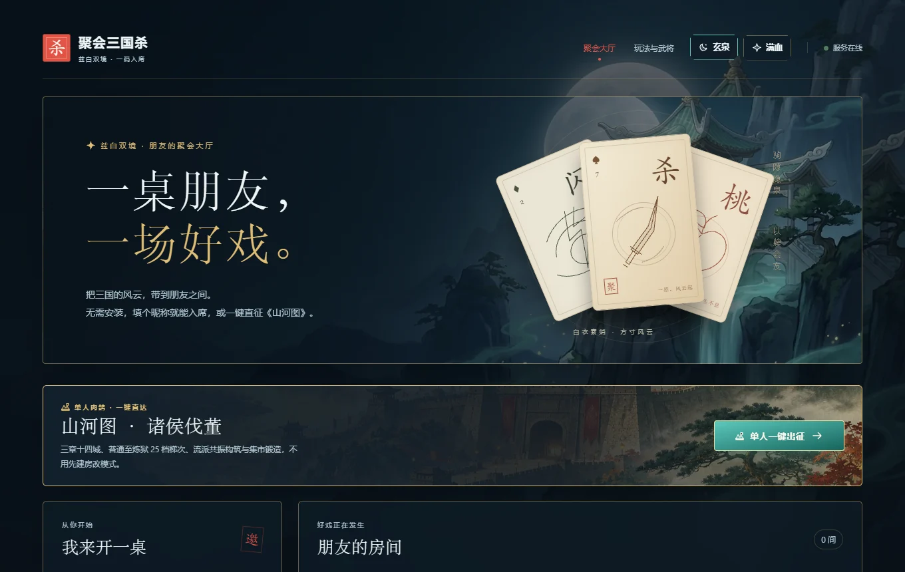
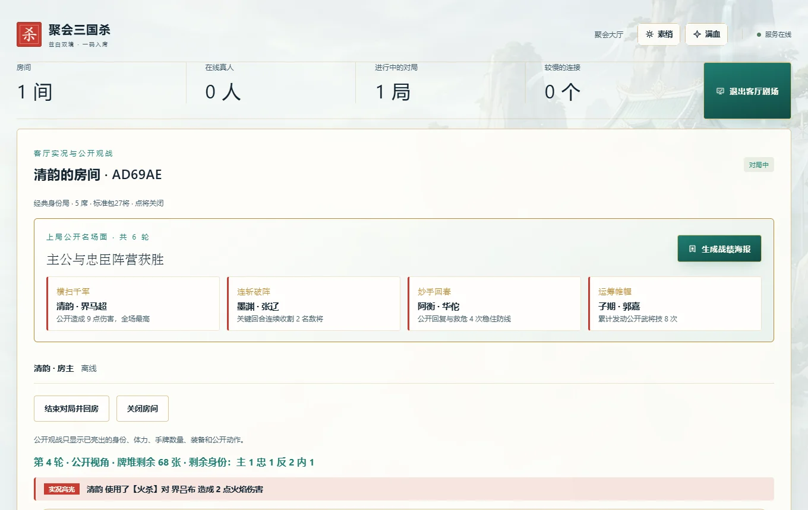
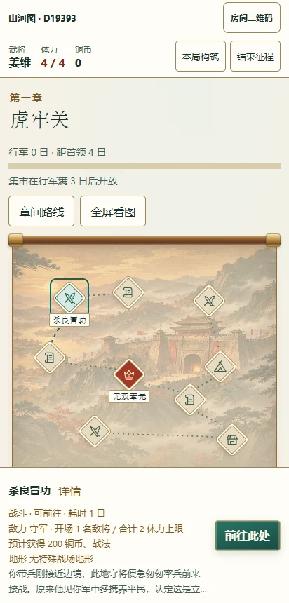

# 聚会三国杀 · Party Sanguosha `v1.0.0`

> **一桌朋友，一场好戏。**
> 一台 Windows 电脑双击启动，手机扫二维码即刻入席——无需安装 App、无需注册账号、无需加好友，同 Wi-Fi 与跨网络朋友同桌开黑；更内置完整单人肉鸽 **《山河图·诸侯伐董》**（普通至炼狱 25 档、十四城）。

[](https://liyan1775.github.io/party-sanguosha/)
[](https://github.com/liyan1775/party-sanguosha/releases/latest)
[](LICENSE)

<p align="center">
  
  
</p>
<p align="center">
  
  
</p>

对局规则、武将技能、原生 AI 与手机牌桌底层来自 [无名杀](https://github.com/libnoname/noname)（固定 `v1.11.6` / commit `2367607e246d21aae168dba15c01151ee0651f30`）。本项目专注于扫码入席、双境商业级游戏界面、客厅大屏剧场、隐私安全公开记牌器、跨网联机与单人《山河图》肉鸽体验；衷心感谢上游开发者。

---

## v1.0.0 有什么亮点？

- **兹白双境商业游戏视觉**：默认通透清雅的「白衣素绡」昼境，一键切换深邃沉静的「月魄玄泉」夜境；应用内自由切换「满血光影 / 精简动效」，并实时免刷新同步至原生对局牌桌与青玉椭圆形牌案底光。
- **单人肉鸽《山河图·诸侯伐董》25 档完整版**：大厅首页一键直达出征，无需先建房改模式；完整覆盖**普通、中等、困难、噩梦、炼狱 25 档**与三章十四城，补齐大谷关「英武壮志」、洛阳「智勇双杰」及噩梦「功成不居」/炼狱「震古烁今」聚会版高难特殊结局；引入流派共振、开局流派包、节点风险掉落预览、80 铜币奖励重随、集市战法锻造/装备回收与征程高光战绩卡 PNG 导出。
- **客厅大屏剧场与聚会 MVP 海报**：PC 端 `/server` 支持一键切换「客厅大屏剧场」模式，自动置顶实时公开观战、高光事件播报、公开记牌速览与上局聚会 MVP 趣味颁奖；支持纯本地 Canvas 一键导出「聚会战绩海报」PNG 发朋友圈/微信群（绝不含暗手牌与邀请链接）。
- **隐私安全公开记牌器 + 原生手势体验**：局内随时拉出鎏金挂轴式**公开记牌器**（仅统计本局已公开弃置与亮出展示的牌面，严守暗手牌与牌堆顺序隐私）；保留无名杀真实点选出牌手势与微信锁竖屏自动横屏牌桌，新增只读选牌防误触提示条，并彻底清除结算后残留的「你正在托管」中央遮挡。
- **极速一键开桌 + 零黑框可视化启动**：大厅内置「一键场景开桌」（3人斗地主 / 4人2v2 / 6人身份 / 高校联赛练习）与自动补 AI 勾选；Windows 端新增 `无黑框启动聚会三国杀.vbs` 与秒开本机可视化启动进度网页，升级保留 `data/shanhetu` 与 `data/rosters` 绝不丢档。

---

## 三步开一桌（Windows 免安装）

1. **下载并完整解压**：前往 [GitHub Releases](https://github.com/liyan1775/party-sanguosha/releases/latest) 下载 `party-sanguosha-v1.0.0-windows-x64-setup.zip`，完整解压到任意文件夹（升级时保留原 `data/shanhetu` 与 `data/rosters` 目录即可延续全部山河册与自定义将池进度）。
2. **双击零黑框启动**：双击 **「无黑框启动聚会三国杀.vbs」**（或「启动聚会三国杀.cmd」），浏览器会立即弹出可视化进度页，首次使用自动从无名杀固定上游下载校验约 441 MiB 资源与约 3.8 MiB 山河图立绘（支持断点续传），就绪后自动跳转客厅大屏 `/server`。
3. **手机扫码即刻开局**：同 Wi-Fi 扫局域网码，其他网络等公网码就绪后扫公网码——两者可加入同一间房。单人直接点「单人一键出征」玩《山河图》，聚会多人点「一键场景开桌」或自定义开房；聚会结束双击 **「停止聚会三国杀.cmd」**。

> **局域网离线聚会**：若现场没有公网，直接双击 **「启动局域网聚会三国杀.cmd」**（所有手机连同一 Wi-Fi 或电脑热点），完全不依赖公网通道。微信锁定竖屏时默认自动旋转为横屏牌桌，横握手机即可自然操作，随时可点顶栏按钮切回竖屏。

---

## 支持的玩法与将池

| 玩法               | 席位（含 AI） | 特色亮点                                                                   |
| ------------------ | ------------- | -------------------------------------------------------------------------- |
| **山河图（单人）** | 1（可招队友） | 《诸侯伐董》三章十四城、普通至炼狱 25 档、流派共振构筑、集市锻造与战报导出 |
| **三国杀斗地主**   | 3             | 先看候选→叫分定地主→选将，标明 1–3 号位，农民只读互看手牌                  |
| **2v2 开黑**       | 4             | OL 常规 2v2：1/4 与 2/3 同队共享 10 将池、队友只读互看手牌                 |
| **经典身份局**     | 5–8           | 主忠反内经典玩法，主公先选并展示，缺位随时补全原生 AI                      |
| **高校联赛练习**   | 4 报 / 3 出场 | 标准 12 局抢 20 分 / 快速 6 局抢 10 分，支持真人代理 AI 队友与待命观战     |
| **单挑**           | 2             | 一人一将快节奏定胜负                                                       |

- **丰富将池与自定义名单**：内置标准 27 将（108 张标准牌堆）、经典进阶 96 将、独立「蚀心入魔」27 将及九档官方活动/高校联赛将池（160 张去木牛流马军争牌堆），见 [官方将池说明](docs/official-rosters.md)。房主还可在等待房间使用「自定义将池」从 666 个已接入原生武将中自由组合、版本冻结并保存至本机 `data/rosters`。
- **完整聚会工具链**：全员可查局外武将图鉴与技能、房主可开启大厅点将、支持免费起手手气卡（每局最多 3 次）、投降/提前结束投票、主动托管与同浏览器断线重连恢复、局间房主转交与离线 60 秒显式接任。

---

## 使用边界与真实说明

- **单机与内存边界**：房间、席位与最多 10,000 条本局公开记录存于内存，停止或重启电脑服务会清空房间；`data/shanhetu`（山河册解锁与结局记录）与 `data/rosters`（自定义将池库）持久化保存在电脑本地，升级时保留该目录即可。
- **公网入口说明**：默认跨网入口使用 Cloudflare Quick Tunnel，无需域名或路由器配置，但临时地址每次重启会变化且不承诺长期 SLA；同 Wi-Fi 聚会始终优先使用局域网直连码，公网波动不影响局域网牌桌。
- **《山河图》聚会版明定规则**：炼狱 1–5 解锁链（通关噩梦 1 开放炼狱 1，逐档至炼狱 5）、「英武壮志」预留敌席龙卫机制、「智勇双杰」预留敌席狂暴枪王入场与噩梦「功成不居」/炼狱「震古烁今」特判条件均在 [山河图调研与规则说明](docs/shanhetu.md) 明确标出与商业服未公开细节的边界。
- **设备验证边界**：v1.0.0 已在桌面 Windows 环境下通过全部 324 项单元测试、39 项 Edge 浏览器端到端验收、23 项固定原生引擎接口测试及真实原生对局自然结算（含「英武壮志」「智勇双杰」与炼狱 4），并沿用此前安卓/iPhone 微信局域网实玩经验；不同手机型号、系统版本与异地公网组合仍建议参考 [试用清单](docs/beta-testing.md) 反馈。

---

## 从源码运行、验证与打包

需要 **Node.js 24.x**。源码仓库不包含第三方游戏素材，运行前先从固定上游准备引擎资源：

```powershell
npm ci
npm run engine:prepare
npm start
```

开发与发布前校验命令：

```powershell
npm run check                        # 类型检查 + 全部单元测试 + 构建 + Prettier 格式校验
$env:E2E_BROWSER_CHANNEL = 'msedge'
npm run test:browser                 # Playwright Edge 端到端验收
npm run test:engine-api              # 固定原生引擎完整接口验收
npm run release:check                # 发布安全、版本一致性与历史密钥扫描
npm run package:windows -- --starter # 构建 Windows x64 启动包 ZIP 与 SHA-256
```

---

## 文件导航、版本规范与开源许可

| 路径                                                                  | 用途                                         |
| --------------------------------------------------------------------- | -------------------------------------------- |
| [在线互动官网源码 `website/`](website/index.html)                     | 零外部依赖静态官网与 GitHub Pages 自动部署   |
| [版本与更新规范](docs/versioning.md) · [CHANGELOG.md](CHANGELOG.md)   | SemVer 版本号约定与历代更新记录              |
| [产品需求](docs/product.md) · [开发交接](docs/handoff.md)             | 产品演进脉络、验收证据与后续边界             |
| [山河图规则说明](docs/shanhetu.md) · [架构决策](docs/architecture.md) | 剧本规则口径、隐私模型与技术架构             |
| `apps/server` · `apps/web`                                            | 本机服务、客厅大屏控制台与兹白双境前端       |
| `packages/shared` · `packages/noname-adapter`                         | 跨端协议、固定无名杀接入、公开记牌与隐私过滤 |
| `scripts` · 根目录 `.vbs` / `.cmd` · `tests`                          | 构建、零黑框可视化启动器与全链路测试         |

- 项目自有代码采用 **GPL-3.0-only** 开源许可，详见 [LICENSE](LICENSE)。
- 第三方代码、图片、音频与字体保留各自原权利人权属，详见 [THIRD_PARTY_NOTICES.md](THIRD_PARTY_NOTICES.md)；公开 Windows 启动包与静态官网均不违规打包第三方游戏立绘或音频。
- 安全反馈请见 [SECURITY.md](SECURITY.md)，参与协作请见 [CONTRIBUTING.md](CONTRIBUTING.md)。
