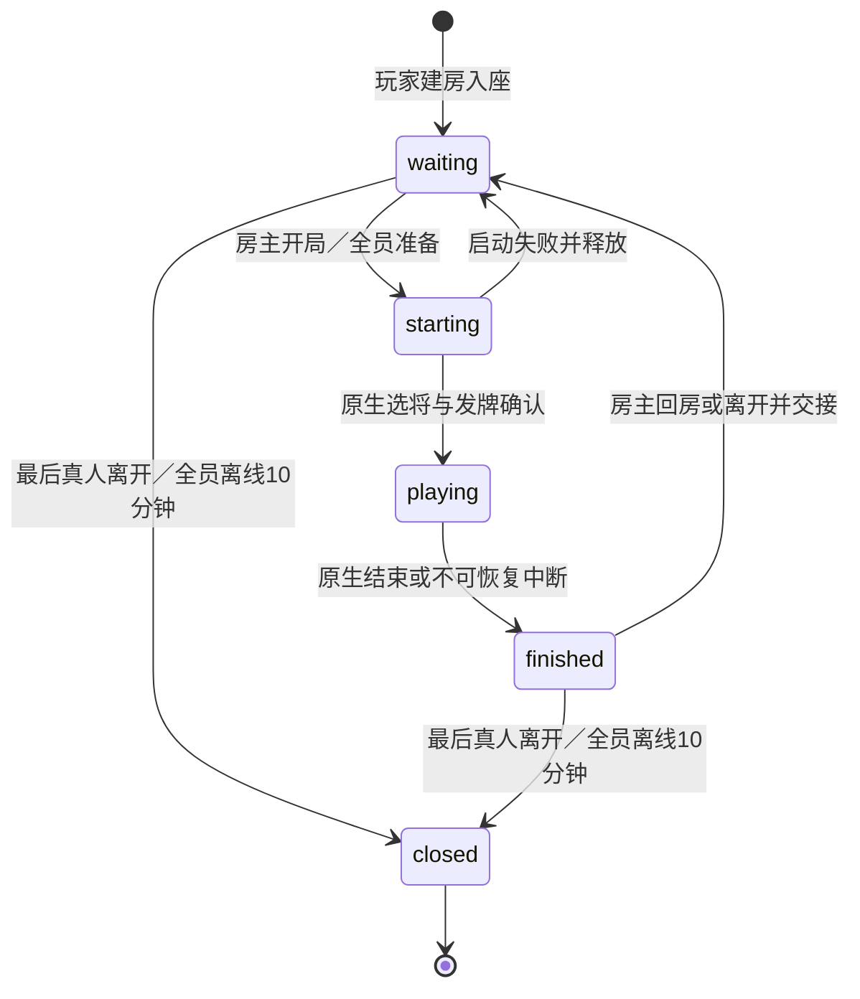
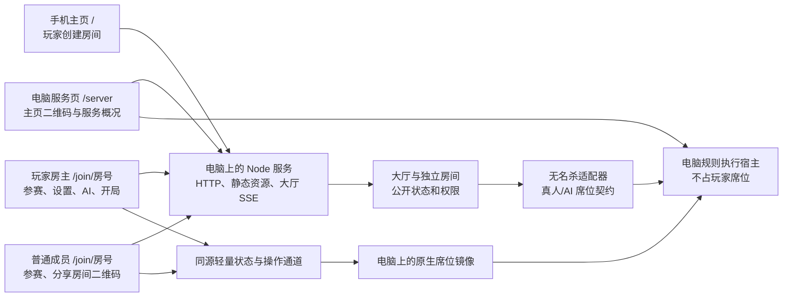

# 架构与决策

## ADR-043：原生触摸确认与首次启动等待

状态：v0.7.12，2026-10-14。用户真实LAN游玩确认核心目标可用，主要阻碍为手机确认／取消误触；外部桌面报告另发现首次初始化约40秒而启动器只等约20秒，具体慢点尚未被证明。

触摸玩家在controls.js中沿用原生ui.create.confirm及Control.replace、回调和选择期限，仅为确认控件添加样式并在原生ui.updatec中更新尺寸。按game.documentZoom折算约80×48像素触摸区和20像素间距；用相邻margin兼容旧浏览器，不依赖flex gap。清除replace累加子宽度时遗漏margin的缓存，再让原生重排完整控件。缩放更新须等ui.control创建后重排，避免boot早期调用updatez报错。规则宿主、鼠标玩家和轻量研究视图不进入该样式路径。

启动等待改为真实耗时120秒，进程退出立即失败；持锁窗口覆盖该等待，重复启动不产生新实例。等待中每约5秒输出提示，服务记录固定资源校验阶段及耗时；保留完整资源及版本校验，不用缓存存在代替可用。超时仍只清理本次启动器创建的子进程，停止仍核验本目录实例和控制凭据。40秒虚拟时钟及35秒真实延迟健康夹具用于验证等待协议，不冒称另一台Windows无缓存的完整引擎启动。

触摸探针先真实选将／发牌，再用同一原生控件的测试回调比较禁用／启用样式、横竖屏及小屏、空隙不提交、单按钮与双按钮复用；恢复原控件后再记录真正用牌、同席刷新和自然结算。UI夹具回调与真实用牌分别给结论，不将样式测试冒充技能执行。

## ADR-042：连接错误隔离与发行验证

状态：v0.7.11候选，2026-10-12。网络探针及原生适配使用同一HTTP升级服务，监听器之外抛出的URL错误、WebSocket未处理error事件会影响整个Node进程；HTTP路由的异常捕获不能保护这些回调。

在adapter/access.ts共用升级URL解析，拒绝非法地址并结束该连接；另一个升级监听器看到已结束socket直接退出。两个WebSocket入口各自消费协议error事件，沿用ws库的正常关闭／原有恢复清理，不主动重启服务、不吞掉引擎执行异常或伪造继续牌局。超限帧仍以1009关闭；回归同时核对下一次健康请求、原规则连接及matchId存活。

本轮建立实现、审查、交付分别记证据的流程：常规类型／单测／构建不能代替完整固定资源、真实原生对局和解压包验证；桌面手机视口不能代替微信真机。`release:check`只扫描当前Git检出及其可达历史中的禁止文件和已知凭据模式，校验版本、许可与引擎基线，不读取被忽略的会话文件；只输出命中路径及行号，不输出疑似凭据。

首发固定现有功能。GPL-3.0-only用于本项目自有代码，第三方来源及资源分发依据分别记录；Windows包必须重建、附源码和许可证、验证哈希、解压启停及同包对局。具体验收与公开前待办见release-readiness.md，不在多个文档维护重复“最新通过”状态。

## ADR-041：依次选人的依赖及宗护成本恢复

状态：v0.7.10补丁，2026-10-12。固定无名杀v1.11.6／commit不变；不修改上游技能、牌堆或AI。

借刀杀人的singleCard／filterAddedTarget声明了依次选人的关系。原生点击取消第一目标后仍保留第二目标，重新选人可能将无武器的原第二目标提交为第一目标。controls.js在真人原生目标点击确实取消后，清除该目标之后的依赖选择、选中样式及提示，再执行原生check；保留所选卡牌和更早目标。独立多目标、自定义目标处理和worker AI沿用原生。借刀第一目标仍由原生武器及可出杀条件过滤，第二目标按原生出杀范围过滤，不额外要求武器。

原生reinit遗漏game.roundNumber，既有接入层只恢复轮数文字；宗护的原生selectCard读取手机轮数，因此恢复后得到零成本。公开轮数显示同步更新手机game.roundNumber；电脑发出的原生转化请求另保留发送时的公开轮数，在重建工厂或重试前恢复。宗护交牌后的olzonghu_backup2是原生子技能，没有chooseButton来源标记，其动态viewAs仅广播一次；适配器对这个明确的已付款阶段同步电脑原生规则，刷新仍恢复同一张杀／闪，无需再交一遍牌。

电脑处理olzonghu_backup结果时，按本局原生selectCard核验正整数成本、唯一实体牌、当前本人he区域、单一其他在场接收者及未发动状态。零张、重复、数量错误和不属于本人的材料不进入原生precontent。拒绝以false返回给选择恢复层，仍按原接收者重放原私有请求，不调用wait、不重置期限或消耗发动次数；已付款backup2不再索取成本。客户端_sendskill仍被拒绝，规则只来自固定电脑定义，私下give(false)及其他暗牌继续走privacy.js和入站卡牌引用保护。

补丁仅使用已有运行模块和出站原生请求，无新增公开API或服务重启要求。新建worker载入修复；已经执行中的worker保留原代码，不热换或重开当前牌局。独立探针完成真实选将／发牌后使用固定材料与轮数，分别核对目标取消、出杀／交武器、宗护杀／闪、恢复、成本与保密，不冒称自然整局或微信真机验收。

## ADR-040：房间回收、浏览器会话与局间房主交接

状态：v0.7.10，2026-10-12。用户反馈散场关页后无对局房间长期保留；原实现只在最后真人主动离开时关房，离线仅改变online，没有回收机制。

RoomStore区分浏览器会话、真人席位、当前玩家房主及冻结的match。LobbyStore在入座前通过GET /api/me签发随机HttpOnly会话，仅复用本机已登记或当前入座的token，拒绝采用客户端自选标识；离房不删除浏览器cookie，避免迟到响应抹掉新房身份。每次入座使用新的公开playerId，网页写请求带X-Party-Player，服务端在读取请求体后验证当前席位，拒绝移除／重新入座前的迟到操作。该公开ID只防止误操作，权限仍由服务器cookie对应的本房真人核验。会话注册24小时后可清理，仍在席者保留。

SSE按连接数维持在席真人的在线状态，HTTP轮询续30秒租约；二者都失效才记录offlineSince并撤销准备。LobbyStore每5秒统一清理租约及无人房间。waiting／finished且所有真人离线时，idleCloseAt取最后离线时间与本次进入局间时间的较大值，再加10分钟；任一真人重连即取消。starting／playing不自动回收，结束／中断后重新给予完整局间保留。AI、未入座观战、公开读取和引擎status广播不更改真人时间。到期复用关闭流程，释放引擎、清空席位、删除大厅索引并取消引擎订阅；旧邀请404。公开快照仅增加期限和服务器时间，不增加私有牌局数据。

局间房主可PUT /api/rooms/:code/owner转交给本房在线真人。连续离线60秒后，其他在线真人可POST /api/rooms/:code/owner/claim显式接任，请求必须带预期ownerId，过时／跨房／短断线请求拒绝；原房主席位保留。开始后两入口锁定。waiting／finished允许成员直接离房，房主离开优先选择在线继任者；finished房主离开同时释放旧局、回到waiting。普通成员回房只在sessionStorage记住已离开的matchId，刷新不再次打开结算iframe；房主回房仍由服务器重置整桌。

每次重置、关闭递增startGeneration；迟到的原生启动成功与失败均返回MATCH_CANCELLED，不能复活旧局或误报新局成功。启动失败释放引擎、清除恢复标记并撤销真人准备。引擎订阅延迟至首位真人有效加入，关闭时取消，避免无效建房泄漏监听。旧Node缺少ownerClaimAt字段时新版页面隐藏新增管理入口；构建本身不重置正式房间，完整启用需按项目启动器停启。

以上改动保持电脑规则宿主与玩家房主两种职责、逐房权限、隐私序列化、原生AI和双网络入口。手机系统对后台TCP关闭的时机仍需微信真机验证；离线从服务端确认的连接／租约失效开始，不承诺从手机物理关屏瞬间计时。

## ADR-039：公开材料共用判定与公开牌池恢复

状态：v0.7.9补丁，2026-10-12。固定引擎v1.11.6／commit不变。

接入层的玩家序列化和公开记录原先各有一份牌面判定，且原生移动存在“先公告／广播、后落入目标区域”的间隙。两者改用privacy.js的publicCardVisible：除原有公开区域与展示事件外，明确visible=true的equip／addJudge／gain／addToExpansion／lose仅公开自身cards；loseAsync只公开对应discard／gain／addToExpansion显式名单。私人ordering、未声明材料和剩余手牌不因此公开。保留真假判定的三态结果，蛊惑隐藏决定不能落入定向消息的默认授权。

虚拟装备及判定牌的原生显示牌不同于实体材料。仅在固定$addVirtualEquip／$addVirtualJudge调用栈内，核对原生广播的玩家、虚拟牌、材料引用及布尔参数后，公开这一张新建显示牌；blankCard不获该授权。恢复只承认仍挂在玩家vcardsMap公开装备／判定上的ui.special材料。公开武将牌上置牌另用WeakMap记录本次原生$addToExpansion的卡牌与接收者，支持单人及loseAsync批次；只在同一拥有者的x区域有效，clearKnowers或再次私人放置立即撤销。不修改原生知情者、牌堆、技能或AI决策。

定向Player.send只对显式卡牌参数及嵌套数组声明的无主材料授予收件人权限，不再将其扩大到预编码父事件、任意对象或其他技能storage。原生chooseButton／chooseToMove／viewCards等已有私有选择授权保持；入站仍按可信现有卡牌ID解析，不接受手机改牌面或动态代码。shenhua的guhuo_guess与old_guhuo_guess／reguhuo_guess一并隐藏质疑期间的实体材料和fake；两种无showCards翻牌的版本仅在精确原生翻牌回调公开这一张牌并重建临时节点。

公开牌池另保留至多16个原生广播创建的活跃dialog引用：必须声明创建dialog及videoId，全部按钮都是本次显式公开材料且无blank／infohidden。重连确认原生arena重建后，先用同编号、当前剩余按钮和公开标题恢复牌池，再重发原待选请求；私人创建、混入新材料、已关闭或编号复用的弹窗不获恢复。关闭即时撤销，恢复不重抽牌、不新建等待或延长期限。五谷丰登每人取牌后的剩余集合沿用原生dialog.buttons，不恢复已经取走的牌。

本次只改既有运行模块，无新增服务端协议或路由。正式服务逐请求读取并重新验证适配器缓存，下一局载入补丁；已载入的规则worker继续使用原代码，不热换正在执行的规则，不重启或清空房间。

## ADR-038：技能对应的将池及牌桌反馈

状态：v0.7.9，2026-10-12。固定引擎v1.11.6／commit不变。

用户明确允许名称不同及额外主公技。官方档仍使用逐项审查的完整原生ID，不在运行时模糊匹配或拼装技能；主公标记、体力、完整技能与AI保持原生。OL界黄忠映射shenhua:re_huangzhong；张绣、刘协、OL界孙坚保留额外主公技。时光场使用公开客户端4.6.0／配置20260911569的326项固定目录，258项匹配、68项记录非主公差异。只导入将池并采用现有四模式和军争160张，定义依赖与实体牌堆分开；onlyOL、tw与yongjian依赖不额外开放角色或洗入牌堆。

旧左慈huashen的owned键和技能映射也是私密候选。动画、独立markSkill参数、skillState及预编码事件均按接收席位过滤，旁人只获数量占位与公开当前化身；reinit专门恢复两种化身状态，不传全量storage。旧化身直接回调选择与旧蛊惑质疑纳入原请求恢复，沿用既有期限。old_guhuo_guess与reguhuo_guess同样先隐藏暗置材料及fake。新版在showCards子事件公开，旧版仅在全部质疑完成后的原生翻牌回调公开该单张材料并写入公开记录；刷新遗漏的临时翻牌节点也在这一公布时刻重建。其他手牌保持隐藏，不改变质疑、真假判定或结算规则。

装备牌的原生click.card会在拒绝非可选卡牌前设置clicked，阻止冒泡后的click.target。仅当所属武将可选、装备本身不可选且没有自定义卡牌处理时转交原生click.target；装备材料与其他点击保留原生流程。玩家配置固定show_cardpile_number，arena创建及轮数更新后恢复原生计数节点显示。规则宿主仍仅广播公开轮数和实际剩余数量；移除父页面重复余牌标签与party-deck消息，不读取牌堆内容。

送花使用浏览器原生Element.prototype.animate，850ms三帧弧线及抵达缩放，减少动态效果时使用140ms淡入。测试需断言坐标移动与抵达目标，不能把SVG存在当作动画正常。桌面隔离Edge未复现原先的完全无动画，减少动态效果的旧分支确有直接跳到终点的行为；真机及用户环境仍需复测。

2026-10-12蒲元补丁：奇思开局直接装备没有useCard祖先。原生equip先声明visible=true，lose将手牌移入ui.special并清除知情者，随后addVirtualEquip在装备DOM落位前广播；仅按位置与知情者判断会把装备错误编码为未知牌，留下infohidden遮罩。privacy及observer在该原生公开equip事件中仅公开其显式cards材料，包括lose子事件及预编码参数；其他手牌、私有排序、未公开选择继续过滤。适配器文件按请求读取并重新验证缓存，新局即可载入补丁，无需改动后端协议或重启内存大厅。

## ADR-037：三档OL名单与角色私密状态

状态：v0.7.8，2026-10-11。固定引擎v1.11.6／commit不变。

10月排位基础151、完整288及SGL第一赛段83名官方目录逐项映射为144、281、82名白名单。完整池前151条与基础池逐项一致；公告重复许褚只计一次，SGL两张名单图地址均保留。角色／技能依赖包与实体牌堆分开，额外定义不扩大可选角色或160张军争牌堆。已有档位不重选版本。平台或机制不同、额外技能或原生不存在的条目明确缺项；固定OL历史参数修订保留完整原生定义，在每将图鉴逐项显示版本备注，大厅只显示档位总体说明。

隐私序列化按接收者投影原生化身的候选、曾选列表与映射，非所有者仅保留数量占位及公开当前化身／技能。涵盖精确drawCharacter广播、markSkill存储参数和skillState重连；不修改电脑权威存储。蛊惑质疑父链中的暗置实体牌不能被普通use/respond祖先提前公开，真实showCards子事件优先公开；父事件预编码还删除非所有者的fake（质疑本身的chooseButtonOL通道不传该父事件）。公开观战沿用同一暗置材料边界。

原生arenaState不带storage，完成化身选择后的刷新也没有待选skillState补发。因此reinit只增加rehuashen专用状态：本人完整原生数据、旁人公开投影；在原生异步重建后的onreconnect节点恢复镜像的数量标记及当前化身，保留已有回调。不传全量storage、不改权威状态、选择或期限。

晋将隐匿初始化按接收者发送角色：本人和规则端使用原生定义，旁人使用席位专属的公开势力、护甲、1/1未亮将外壳，不携带真实将名、隐技能或原始体力。整页重连在原生init之前重建该外壳定义；原生明置开始时只补真实名字和头像，再由原生方法更新体力、技能和显示，不重复init或清空手牌／storage。已经公开的副将与额外技能保持可见。

蛊惑质疑使用开局后的原生chooseButtonOL直发通道，不经过普通GameEvent.send。恢复仅识别该选择、reguhuo_guess祖先及原生五参数请求，保留逐席原请求与原生等待；客户端重建确认后重发。断线不立即转AI，提交／原期限到期后清除，其他私人弹窗不能覆盖该请求；不增加wait、不复制质疑父事件或延长期限。

宴戏仅在原生yanxi的“展示了”三张材料发布点记录明确集合，允许其中已返回牌堆的两张公开；其他牌顶与手牌仍隐藏。observer与玩家传输共享该发布识别，避免日志包装顺序差异。诫厉仅对声明给执行者的chooseToMove及零出牌chooseControl对话材料授予私有可见性，旁观者不获权限。编号技能说明使用静态AST读取固定数组拼接模式，不执行上游函数。实局、单测与未覆盖动态分支见handoff.md。

宴戏猜牌期间刷新，恢复同一公开三牌弹窗和原videoId；本人继续原猜牌请求，旁人仅恢复公开牌池。videoId读取原请求_set，并核对当前dialog为原生由数字转换出的同一DOM及仍连接，避免把其他私人弹窗当作公开牌池。不重抽材料、不揭示答案或其余手牌、不新建选择与期限。

## ADR-036：重铸公开边界与96将白名单

状态：v0.7.7，2026-10-11。用户确认保留72将并再增24到96，固定上游与完整原生角色／技能不变；OL张绣特例仍仅限已确认的官方档。

原生recast在调用loseToDiscardpile前就用game.log公布重铸材料，后续移牌关闭重复日志。因此在privacy与observer两处一致补入该事件明确的cards，才能同时保留协议中的公开牌面和首次写入的历史文字。不按“重铸”日志文字猜测、不公开通用lose／ordering，也不因移动函数名字含discard就开放回堆；新摸牌及未重铸手牌仍按接收者过滤。

新增法正的原生xinxuanhuo.filterTarget捕获局部target2，原生函数文本序列化不会保留此绑定。仅在该父事件、chooseToUse和固定函数字形同时匹配时，以worker原闭包求出唯一指定目标，在发送的set中携带公开玩家引用及无闭包过滤；不覆盖worker的原生filterTarget，不扩大通用解析或接受手机代码。原待选请求保留这组字段，刷新不重新选目标／延长期限。

96将继续以固定ID白名单控制范围，原72个具体版本与顺序保持，每局冻结开局配置。定义依赖不等于角色授权；名单、跨端说明、图鉴和素材仍通过现有生成器及固定Git blob核验，不覆盖原生技能、体力、AI或牌堆。基础档选将以熟悉、B−／B一般评分和短文本初筛，平台活动档继续单独核对，不能自动套用官方平台版本替换或扩池。

## ADR-035：自动保存、公开观战与聚会牌桌反馈

状态：v0.7.5，2026-10-11。用户确认经典进阶保留原48将并扩至72将；固定上游v1.11.6／commit、原生技能及出牌AI保持。

房主设置以600ms防抖合并、单通道串行PUT提交。设置草稿有独立修改序号，等待中的旧响应只更新已保存快照，不覆盖之后的编辑；失败保留草稿与重试入口，未保存时锁住准备、AI管理和开局。失去房主或离开等待状态清理待提交草稿；权限继续由Node按当前房间真人会话核验。

GET /engine/observe/:matchId?room=房号允许LAN／公网的晚加入者读取当前房间的公开ObserverState和ObserverJournal分页。必须匹配活动局与房号，GET／HEAD只读、no-store；只返回白名单公开投影／文字和分页整数，不返回setup、选择、原生序列化、token或网络通道。公开房间页使用独立room-spectator，不创建原生iframe、不入座、不访问玩家通道。电脑管理API仍限本机，入座真人的history认证保持。换局、房主回房或释放后拒绝旧局请求，页面按generation丢弃迟到响应。

新experience能力声明启用public-summary.js和牌桌工具条，旧Node未声明时不加载新模块。worker以既有公开observer为唯一来源，身份人数使用5–8席开局分布减去公开阵亡身份；不读取存活者的真实身份。最近三条用牌／响应／弃牌／技能／判定结果按原日志序号去重，阶段切换不挤掉动作，最新摘要缓存并在已绑定原席位reinited后补发。所有文本textContent，父子状态消息严格校验同源、当前iframe与matchId。

主动托管／恢复手动复用原生auto／unauto，phone仅请求切换自身，worker仍由原Client绑定本人；父页等待party-control确认后更新按钮，恢复中和结束后禁用。重复请求按期望状态幂等，重连保留实际托管状态。所有档位使用slow、1000ms基础delay，保留原生动画、额外技能等待、选择截止时间与真实网络延迟。

chooseButton默认评分1会固定取已排序候选首位，适配器改为上游联机选将使用的Math.random评分；不改用牌AI或常备主公逻辑。斗地主以每席身份计算地主10／农民6，候选总数22且不重叠，不足明确拒绝；身份候选5／3或10／6、2v2十将共享和单挑五将保持。

曹冲问题来自上游get.filter的声明数据被infoFuncOL当函数文本清洗。phone仅对_noname_func:[开头、JSON两项条件与非负整数索引的合法recipe，以原生get.filter重建过滤器；其他函数／错误材料仍走原解析，不更改技能或放宽入站动态代码白名单。弃牌可见性只增补原生显式loseAsync(type=discard, visible=true)的lose_list及非blank loseToDiscardpile.cards，在日志先于移动的时刻准确公开指定弃牌，不公开旁人剩余手牌或整个ordering区。worker监听ui.cardPile实际子节点变化，在已开局时只广播轮数和剩余整数，补首次发牌及移牌后的计数，牌ID／内容／顺序不输出。

72将注册refresh／shenhua／sp／yijiang后仍按固定白名单裁剪，原48个版本与顺序保留。OL界徐盛重新核对官网完整破军增伤条款，补入相符的mobile:re_xusheng；张绣现成异版附加海外技能，继续明确缺项。资源、图鉴和跨端元数据由受版本管理的配置生成，固定Git blob核验，不修改上游源码。验证分别记录领域／权限、桌面浏览器、真实原生夹具与未注入自然整局，真机微信另行复测。

## ADR-034：玩家公开记录、只读资料与规则连接恢复

状态：v0.7.4，2026-10-10。上游版本／commit、将池、卡牌规则与原生AI不变。

controls包装原生ui.updateRoundNumber，仅向本人的父页发送实际余量；observer同样仅投影ui.cardPile.childElementCount整数，Node白名单限制范围，不发送牌或牌堆顺序。GET /engine/history/:matchId复用ObserverJournal，每页最多100条、整局10000条公开文本，no-store；每次验证party_player对应当前房间与冻结的真人席位，未入座、跨房、仅宿主cookie和已释放对局拒绝。手机与电脑复用记录呈现及缺批补取，全部textContent，换局拒绝迟到页且不回退保留起点；记录窗口不暂停原生引擎。公开语义仍以原game.log与observerCardVisible为边界，未把私人选择或整个ordering区公开。

原生get.nodeintro／charactercard在真正调用时关闭收藏和换肤偏好，避免boot之前lib.config尚未初始化；强制noedit=true并移除禁用／收藏节点。查看详情先走原removePop关闭旧介绍与poplayer，避免透明层挡住技能按钮；保留原生技能、台词和返回生命周期。原configMenu／connectMenu访问器与Node入站白名单继续提供独立权限保护。

新setup.ruleRecovery仅对新Node的worker启用rule-socket.js。模块闭包产生本iframe的execution nonce，共用于本机规则与时钟线路，不进入玩家setup、大厅、记录或日志。Node首次绑定后只允许相同实例恢复；已在线重复连接、不同nonce、手机cookie或公网来源仍拒绝。意外断线给原Match最多20秒恢复，保留同一个worker与游戏内存，不能用新iframe或新开局续接旧局。双向消息缓冲限512条／4MiB，玩家入站仍按原认证／白名单／source检查，连接管理与动作保持顺序；释放／失败清空，旧socket与旧match不能发事件或改新局。

RuleClock在同实例暂时断线时保留Node原定时器，参数及函数仍仅在worker。已到期ID保留至worker确认，涵盖发送后尚未确认的在途断线；重复单次ID在worker只确认、不再执行回调。重复计时合并一个待交付ID，取消可删除待交付ID，不延长原期限、不积压播放历史tick。ack仅随新ruleRecovery启用，旧计时协议保持。原生私有选择重放继续走selection-recovery与privacy。规则恢复事件令手机锁住旧画面，恢复后各自重建原席位，防止断线前在途帧丢失留下陈旧牌桌。

运行中的failed转finished并附固定枚举matchFailure，不等同原生结算、不判胜负；手机保留锁住的牌桌和明确原因，禁用失败局自动恢复／最终结算重取，回房沿用成员等待和房主释放权限。starting失败仍waiting并保留原因提示。失败、恢复中的Match仍隔离，正常自然结算不走错误分支。普通诊断只记录时间、房号、matchId、模式、规则线路、关闭码与固定原因，不打印异常堆栈、原生payload、昵称、卡牌或token。该恢复不覆盖Node重启、电脑页面刷新或系统休眠丢失内存。

## ADR-033：原生输入、队友代选与牌桌提示

状态：v0.7.3，2026-10-10。固定上游v1.11.6／commit保持，全部修改在适配器、网页与明确将池配置内，不覆盖技能规则。

bootstrap依据实际触点和主指针类型设原生touchscreen：手机使用touchend，桌面鼠标使用click。上游Card／Button／Player／Control仅绑定其中一种事件，不能为所有浏览器强制触屏。wuxie_self=false关闭「不无懈自己」偏好，原生无懈合法性不变。

2v2在原chooseButtonOL批次建立本局AI席位到真人队友的映射，只读冻结setup.seats.kind，不以暂时离线／托管认定AI。真人控制请求原十将池selectButton=2，保留选择顺序、本人点将与明确自己／AI标记；原生序列化及selection-recovery重放同一请求，不新建wait或期限。worker复核数组、两个唯一候选及原池，原子确认后拆回两席结果，再沿用原生init与势力选择；不收客户端指定的被代选席位。纯AI／双真人队伍走原路径，超时双选仍调用同一个原生选择AI。

audio使用每iframe一个主GainNode和同入口localStorage音量偏好，默认35%，改变音量直接更新主输出。0%停止当前／待播，显式开启恢复35%；普通静音和积压丢弃保持。父子状态消息验证原同源、iframe和matchId，不上传设备偏好。菜单礼物复用认证原生throwEmotion命令，worker核对当前Client、目标及枚举，间隔200ms；仅增加本地SVG和textContent发送者／目标／连送次数，2.5秒自动清理、后台不补播，保留动画12节点上限。

非规则页面包装原生Dialog.open／close，在当前非peaceDialog询问前暂藏ui.dialogs中保留的static背景；原Dialog和材料均不修改，结束时按原焦点恢复。前景面板提供背景避免与公开出牌动画重叠。原生glow_phase使用金色外框及独立DOM标记，避免复用原选择伪元素；reinited后按权威currentPhase及真实阶段高亮补发公开状态，不读取手牌、身份或storage。

官方映射更正刘焉为sp:liuyan，并按原生版本差异将OL界徐盛列缺项；生成器重建白名单、元数据和图鉴，旧已开始对局仍用开局快照。定向测试分别记录桌面鼠标、模拟触屏、真实原生材料夹具与未注入自然结算，不当作微信真机或全部技能验收。

## ADR-032：按模式确认的投降与已确认结算恢复

状态：v0.7.2。

新服务在状态和私有setup声明surrender能力，runtime/surrender.js按标记加载；旧Node没有声明时不载入新模块，手机不出现新入口。手机工具条的说明和投票窗口放在旋转牌桌之外，昵称全部textContent，父子消息核对同源、当前iframe和matchId。request／approve／reject共用已认证且有序去重的WS／HTTP／RTC通道，Node白名单限制字段和epoch；不接受指定投票人、阵营或胜者的参数。

每局规则宿主的闭包保存唯一投票、原截止时间、同意集合及按发起人计的60秒冷却。再验证当前Client是否属于该席位、真人资格、存活条件和投票epoch。斗地主与2v2仅按公开阵营取存活真人，单挑取本人；身份局取固定全体真人（含已阵亡），投票状态不读取或发送隐藏身份。AI不占确认票数，真人的托管或断线不是同意。30秒未通过、任一否决或存活真人队友变化取消；重连不改期限或票数，不因阵亡减少人数自动通过。

全票通过后为该局固定checkOnlineResult：公开队伍认输时本方失败、对方获胜，身份局全体结束时返回null。调用原生game.over，不修改HP／手牌、不伪造死亡和技能触发；自然结束与释放清理投票计时器。适配关闭原生个人死亡型giveup入口及旧命令，防止绕过团队确认；电脑不取得投票或玩家房主权限。

原生reinit只还原state.over，未还原结算窗口。投降／全体结束时暂时捕获原生Player.send中的结算HTML与原生手牌提示Map，调用后立刻还原发送方法；材料仅在该局私有内存，仍经privacy.js按接收者序列化，不进大厅／观战／普通日志。确认reinited后，按权威原结果重发本局原生结算方法和材料。客户端仅重建展示，规则宿主不重新结束、不重算胜负。回房继续沿用只有房主释放旧局、普通成员可先回房等待的原流程；服务重启不保存材料。

## ADR-031：牌桌通道恢复、私有手气卡与矢量互动

状态：2026-10-09，源码v0.7.1。新Node声明connectionRecovery／luckCards，setup另声明emotions，运行时模块按能力安装；旧正式Node继续旧协议，构建静态资源不会强制释放已有房间。完整启用需要停止并重启本项目实例，房间内存与公网入口变化必须向用户说明。

PlayerTransport每5秒通过当前认证游戏通道发送partyPing，由本房规则宿主回复partyPong，超时8秒；WS、HTTP、持续推送与RTC走相同动作／回复路径。首个失败持续警告并禁止旧牌桌操作，连续两次失败关闭失效连接并同席重建。普通游戏帧与/api/health不清除这一故障。离线立即提示，前台返回先探测，pagehide清理且不触发旧iframe的恢复回调；样本包含实际规则回复往返。普通大厅快照更新不覆盖异常提示，重建只在原生reinited后的party-control确认完成后解锁，禁止仅凭载入或TCP打开宣告恢复。

Node把普通网络关闭传为disconnect，认证拒绝和连接替换传为强制close。connection-recovery在服务识别断开后最多20秒保留原生Client与虚拟socket，标记reconnecting；同席新连接取消原定时器并走原生reinit。HTTP手机离线且无法送达DELETE时，既有PollChannel的45秒空闲期限先到期，随后进入同一缓冲；前端离线提示和原选择期限不受这一服务检测等待影响。到期调用原Client.close，已有selection-recovery继续保护未完成选择的原期限；不改规则、AI、胜负或牌局时钟。关闭按socket幂等，旧通道重复关闭不能再次处理已重入席位。所有玩家引用广播在重建完成后发送，避免空牌桌解析引用异常。主动托管状态不随重连抹掉，权威控制状态只发本人，旁人／本机观察者仅见公开连接与托管信息。

luck-cards由worker在initialDraw后、started确认与phaseLoop前运行，私有闭包保存本局epoch、30秒截止时间和真人各3次额度／revision／done。只有当前本人原生Client可提交partyLuck；Node先校验数据白名单，worker再校验当前阶段、截止时间和revision。重复及晚到操作不消耗额度，重连只恢复本人剩余次数与原倒计时。全员完成或到期结束；AI不参与，启动超时预算增加30秒。

刷新先按原手牌数量从原生堆取新实体，再通过privacy包装广播移除尚未公开的原牌，清除gainTag和knowers后随机放回堆，再directgain新牌，更新_start_cards。不走弃置、失去或获得技能事件；私有手牌仍经原privacy.js逐席授权，控制状态不携带牌面、堆序或实体ID。大厅和普通日志没有手牌、候选、身份或token；原牌与新牌总数守恒，2v2起手数量及先手少摸规则保持。

emotions在适配器替换原生$throwEmotion，使用四种固定内联SVG、画布缩放后的玩家中心与短飞行／命中，保留本地原生音效。原生交互菜单的_close回调绑定实际poplayer，发出表情后释放透明触摸遮罩；构建资料／交互菜单时暂不扫描未配置的皮肤目录，保留原技能说明与头像，项目不开放文件系统浏览端点。最多12个节点、pointer-events:none、后台清理、3秒以上积压丢弃，并支持减少动态效果；worker不绘制。Node仅接受原生玩家引用和四个固定枚举，拒绝函数／事件标记（含JSON解码后的Unicode转义）；worker验证真实来源、合法目标、非本人及500ms限流。没有修改上游素材、放宽任意执行或新增远程依赖。

验证包含规则端边界测试、持续遮罩页面检查及独立真实原生手机视口：3次刷新／重复与第四次拒绝／重连原期限、下行静默但网页健康正常、超过20秒真实离线、同席恢复和手动接管、原生菜单触摸广播SVG。自然四模式回归继续核对牌堆、逐席隐私、AI结算与回房；桌面Edge／WebKit结果与微信真机分别记录。

## ADR-030：首次牌种同步与原生转化选择的规则归属

状态：2026-10-09，v0.7.0 适配修复。魔吕布点击罡拳后材料全部不可选、OL谋关羽首次入场没有威临按钮已在独立桌面手机会话复现。原生 prepareArena 在手机连接前构建实体牌堆，其广播没有接收者；自定义首次入场缺少 lib.inpile / lib.inpile_nature，原生 reinit 则已有这两项。mode 的逐席初始化补发规则宿主生成的公开牌种和杀属性列表，在选将及首次技能选择前应用；不发送牌堆实体、顺序或顶牌，不另造牌种列表或扩大军争配置。

手机仍移除原生 autoConfirm。controls 在本人的 chooseToUse / chooseToRespond 中，仅当当前技能声明 chooseButton、没有 viewAs、原生检查合法且尚未选择任何材料时，提交打开选项的中间结果。该结果只导航至原生技能选项或材料页面；选项、多材料、目标、实际用牌与响应仍由用户明确确认。锁定技、托管、超时及电脑原生 AI 保留原行为，不覆盖武将规则。

第三个故障是手机原生 chooseButton 流程把动态 `_backup` 定义放进 result._sendskill；入站网关拒绝函数，导致最终发动被拒绝。手机完成无材料导航后直接返回该结果，电脑执行原生选项工厂、生成规则与后续结算。主动技能导航用原生 filterEnable 校验；实际选项仍由手机原生 chooseButton / chooseControl 选择。只对这一原生父子选择链，记录 Dialog 声明的 add/addText/addSmall/addAuto/addNewRow 操作，在当前选择者手机重建弹窗；不序列化 DOM、不读取整手牌或扩展广播。

动态规则的原生选择值随当前私有请求发送；手机用已载入的同版本工厂重建显示/筛选闭包，避免函数文本丢失 captured links（如智绝颜色）。实际规则始终留在电脑。保留原 GameEvent.send 名称、参数与父事件；规则/弹窗作为同一请求的附加参数经原 privacy 授权发送，selection-recovery 保留原请求与截止时间，刷新恢复同一分支。重建的材料选择允许取消；在原生 restore/check 前按原生 close 生命周期清理旧确认控件，避免相同取消状态复用 removing 控件而挡住再次点击。电脑收到下一结果时也恢复原选择，再处理取消后的卡牌或技能导航。非此链原生已有备份按电脑定义同步。Node 拒绝任何客户端 `_sendskill`，含无函数的伪造定义；worker 同样拒绝，以兼容未重启旧服务。函数/事件标记拦截、实体卡牌引用保护和逐接收者过滤保持。

check-native-definitions 另生成 native-interaction-audit，记录八档静态技能闭包中的牌种/属性依赖、chooseButton 入口及关联武将。该审计只提示共同前提，动态获得技能和额外私有数据仍需实测。engine:verify:rooms 核对所有首次入场手机的公开牌种/属性与规则宿主一致；engine:verify:skills 使用独立四真人夹具、原生触屏操作和技能结算检查威临、罡拳及奇策、观骨、智绝，覆盖取消重选、闭包、刷新原期限与暗牌。夹具固定座次、在真实选将发牌后暂停自然回合，再准备材料/标签/技能状态；与未注入自然整局、微信真机证据分别记录。

## ADR-029：本机推送驱动规则计时

状态：2026-10-08。真实反馈为手机操作等待、AI动画间等待过长及停止出牌；正式单挑的公开记录仍推进，但间隔达到分钟。规则宿主在电脑浏览器中运行，原生game.delay与选择期限使用浏览器计时器；隐藏页面可能将连续计时器合并为每分钟一次，参见[Chrome计时策略](https://developer.chrome.com/blog/timer-throttling-in-chrome-88/)。原QA启动参数关闭了后台限制，不能证明普通浏览器后台运行正常。

每房规则iframe在载入引擎及沙箱前，通过独立的`/engine/socket/:match/clock`连接本机规则时钟。路由沿用宿主cookie、同源与本机来源验证，普通玩家和公网均不能连接。浏览器替换本iframe的setTimeout/setInterval及对应取消函数：函数、参数与选择材料仅留在该房内存，服务只接收负数计时ID、原延时与是否重复，到期只推回ID。负数ID不与安装前的浏览器计时器冲突；原生延时、AI与选择期限不缩短、不重新开始，手机计时器保持原实现。

Node的RuleClock按连接管理计时器，验证类型/范围并限制每房8192个待执行计时器；取消、连接断开、对局释放和服务关闭清理。计时连接中断使该局报告服务失败，避免静默退回受限制的计时器。setup仅为worker声明ruleClock；未重启的旧Node没有此标记，bootstrap跳过新路由，既有房间不因静态代码构建受影响。正式采用新协议需要停启服务。固定上游源码、原生AI、规则、隐私与权限边界保持，CSP无需放宽。

后台验证使用独立Edge进程和临时测试profile，通过Playwright connectOverCDP的noDefaults保留真实页面可见性，不启用后台豁免；仅用官方测试开关把隐藏宽限期由五分钟缩为十秒。测试条件从Node观察，因为隐藏页面的requestAnimationFrame本来就停止；此观察方式不修改游戏、计时器或可见性。普通QA与后台QA的策略分别写入结果，桌面WebKit/微信UA及真实手机验收仍分别记录。

## ADR-028：官方将池的版本证据与按档资源

状态：v0.7.0，2026-10-08。保留固定v1.11.6及commit，不覆盖上游源码。config/official-rosters.json记录完整官方名单、游戏平台、届次、公告日期/链接、逐项原生ID/包/技能及缺项依据。update-official-rosters只校验已审查映射，生成明确白名单、共享元数据和研究文档，不以名字自动匹配。无法对应本平台版本的角色保留公告条目但不进入运行时；新将池复用四模式和160张牌堆，不导入赛事流程。

共享GENERAL_PRESETS只含浏览器安全的显示资料和ID类型，不含角色/技能定义或Node代码。房间和图鉴共用此目录；来源及实际/公告数量、缺项在房主设置和成员摘要中可见。图鉴支持公告别名与晋势力；运行时仅在白名单含原生晋将时保留lib.group的jin，势力选择仍由原生get.selectGroup产生。白名单、点将权限、换档清理与每局冻结沿用ADR-023/026/027。

图鉴构建为每档独立JSON，服务端只开放已知档位路由。浏览器按所选档位读取并缓存独立Promise，迟到的旧档响应不覆盖当前档位；完整目录保留为兼容资源。setup头像/别名限定本局白名单；音频生成器从本档技能依赖、语音重定向/阵亡资源生成audioFilesByPreset，只传本档目录，共用卡牌/效果语音保留。音频仍逐项按需下载。

派生头像逐文件保留缓存版本：同commit、相同图片字节沿用旧URL，新图以内容哈希作为缓存版本，新增其他将池不会刷新标准档已有头像缓存。changeSkin/characterSubstitute对应的固定立绘一并核验/派生，portraitVariants只随本局白名单主角色提供，不授权额外形态选将。原图与固定blob校验保留；Unicode原图使用安全ASCII派生文件名，下载清单允许Unicode字母/数字而不允许目录分隔符。定义仍按当前definitionPacks加载，标准档四个角色依赖包和标准牌包未扩大。

静态提取只解释文字常量、技能poptip、常量拼接与明确数组poptip格式，不运行技能或翻译getter；随机“劳燕/牢燕”getter在图鉴显示首个字面名称。选择/可见性静态审计只是依赖与入口覆盖，真实对局、定向隐私探针和微信真机验收分别记录在交接中。

## ADR-027：四模式按档位选择牌堆

状态：v0.6.9，2026-10-08。用户确认标准27将使用standard108张，进阶48将使用standard＋extra并排除muniu，160张。四模式保持现有变体和规则，不引用singlePile、online_cardPile或cardsFour。roster-presets schemaVersion 3 增加cardPile的id/name/packs/excludedCards/cardCount；definitionPacks仍负责加载规则依赖，zhulu不进入实体堆。

NativeNonameService在释放旧局前验证批准的档位映射，start深拷贝整档；所有角色和重连setup沿用快照。card-pile.js共用于Node校验和浏览器构造：bootstrap选择本局config.cards，mode在onfree/prepareArena之前从已载入的原生模板排除muniu，校验总数及定义，不覆盖卡牌规则；configOL.cardPack同源，bannedcards同步排除项。原生create.cards因此不会把木牛加入实体牌或inpile，原生仁德等可从进阶inpile看到酒和火/雷属性杀。

新服务通过status/setup.cardPilePolicy显式声明能力，运行模块仅在此标记下导入；未重启的旧服务继续standard108，不请求它无法提供的新路由。房间页按实际服务能力显示牌堆，服务器未更新时明确提示108与重启要求。大厅只含静态说明，不读取当前剩余牌堆、顺序或手牌。

军争定向测试发现火攻的showCards广播弹窗不在arena reinit中。selection-recovery仅在本人未完成chooseToDiscard、原生huogong父事件仍有打开的videoId弹窗、单张cards2已对本人公开时重建这张展示牌，再重发原选择；沿用原编号、材料与计时器，原closeDialog清理。不捕获其他广播、不读取目标整手牌或storage，也不放宽privacy.js/入站引用保护。

engine:verify:rooms按研究清单核对原模板的聚合牌种/属性数，不输出原模板的洗牌顺序、当前剩余堆或实体ID。独立engine:verify:military固定测试候选、补材料和判定牌，跑真实原生交互/结算，结果只保存布尔值和数量；该夹具不等于未注入对局的自然结算证据。两档四模式自然整局另行验证，微信真机仍需复测。

## ADR-026：原生武将白名单与单局冻结

状态：v0.6.8，2026-10-07。两档为用户确认的标准包27将和经典进阶48将，全部只选择固定核心已有角色，不改写OL规则。标准注册standard/old，进阶注册refresh/shenhua/sp；其余包仅提供依赖。roster-presets schemaVersion 2 的 characters 是真实原生 ID 白名单，保持协议 ID beginner/advanced 和四模式候选数量。definitionPacks 加载规则依赖，enabledPacks 决定哪些原生角色包注册到 lib.character；两者都不能扩大明确白名单。

roster-policy.js 共用于离线生成和运行时只读校验，拒绝 characterOverrides、重复或缺失角色及缺失技能；不复制角色或覆盖原生技能。袁术直接选 old:ol_yuanshu，依赖 standard/refresh/sp/old 原生定义与现成妄尊、同疾。bootstrap 仅在新服务 rosterPolicy 标记下启用 standard/old 角色包，再由 mode 白名单裁剪。已移除 ol-skills.js 及其路由、文案、静态审计入口；没有修改固定上游源码。

NativeNonameService 在 start 时深拷贝本档完整配置，worker、玩家和重连 setup 使用同一快照。明确 rosterPolicy 标记才加载新模块/规则；旧服务没有新模块路由和冻结逻辑，继续使用 legacy completePacks/packGroups 完成旧局。旧整包字段仅供过渡兼容，新服务及离线工具只采用 characters；正式服务必须在无人对局时重启才启用新将池。保留牌面过滤和入站引用校验。

update-native-inventory.mjs 静态读取同一 commit 的普通武将包、game/package.js 与 character/rank.js，不执行第三方技能。生成完整清单和结构化目录，不自动加载扩展或改产品白名单。上游强度标记只供下一轮筛选参考，尚未开放的角色仍须验素材、选择序列化与私有数据；本轮保留既有隐私过滤和入站牌引用保护。

## ADR-025：OL 2v2 共享将池、确认冲突与先手补偿

状态：v0.6.6，2026-10-07。用户选择 OL 常规 2v2。适配器替换上游 start 后漏设 `_status.first_less`，使第一回合仍按默认两张摸牌；`initialDraw` 在原生发牌/回合开始前设置该标记，沿用原生 `Player.phaseDraw` 对 `game.phaseNumber === 1` 的减量，后续回合、技能和其他模式保持原路径。四号位判断使用固定 `previousSeat`，起手仍为 4/4/4/5。随机座次、1/4 对 2/3、阵亡队友可选摸一张与全灭胜负继续复用原有实现。

generalChoices 在分配行动位后按 side 为两队各抽 10 名不重叠武将；先把本队大厅偏好加入池中，再随机补满。两名队友获得内容相同的独立数组，本人偏好排首位，数组始终保留十名。使用原生 chooseButton 的单参数对象接口，partyTeamChoice 只记录本人 preference 与队友 taken；原生 filterButton 为本人点将加标签，队友已选加标签、灰化并拒绝选择。每队同池可任选，不把偏好锁给个人。只有该席原生按钮请求携带本队候选及该席状态，手机 setup、大厅、观战仍不携带整表点将或将池。

原生 chooseButtonOL 批次期间临时包装 unwait、tempUnwait 和本机 chooseButton 的 forResult。只在原等待中收到单名合法最终确认或原生 AI 完成时占用候选，先记录再调用原 unwait，保证同队同将只有一次成功。tempResult 不触发原等待回调；同将/非法确认不结束等待，selection-recovery.js 的私有 replay 重发原请求及剩余候选，不再 wait/pause 或更新期限。本机 AI 若同时返回同将，用原生按钮 AI 在剩余池重选，并禁止再请求超时真人。已确认席位的神将势力选择仍使用原流程。

确认后仅向同队另一席发送已选名与标题，更新其原请求的 taken 并重新检查弹窗；若它恰好被暂选，撤销该次暂选，其余合法暂选保留。规则端同时拒绝 taken，防止显示中仍存在的按钮或在途结果重复占将。filterButton 随原生请求序列化，不依赖新客户端辅助函数；首次弹窗前 AI 已选、即时更新与刷新均显示完整十将和同样的标签/禁选状态，已完成不重弹。标签仅在文字变化时改 DOM，避免与既有 MutationObserver 形成循环。批次结束或抛错时恢复全部原方法，不把临时包装带入后续技能操作。隐私重放仍经原接收者与选择授权过滤；大厅和公开观战全桌选完后才获知武将。

规则说明和来源保存在 product.md 与 config/mode-rules.json；未修改固定上游源码、版本或隐私过滤。选将验证器可观察真实发牌数量、首/后续回合及自然阵亡补牌；测试路由仅把双真人固定到 1/4 位验证队友提示，不改变牌堆、伤害、AI 或胜者。

## ADR-024：独立的大厅视觉层

状态：2026-10-07，v0.6.5 工作区的非牌桌页面改版。参考 [Apple iPhone 页面](https://www.apple.com/iphone/) 的信息层级与单一视觉重心，以及 [SpaceX 官网](https://www.spacex.com/) 的深色背景、大标题与克制强调；采用适合本项目的墨色、宣纸和朱红，不复用其照片、字体或品牌素材。

`apps/web/src/lobby-art.ts` 提供原创 SVG 模式图标、装饰卡牌和房间意象，固定界面字符串与玩家昵称分开渲染；昵称继续走 `textContent`。`lobby-theme.css` 导入原 `style.css` 的功能基底，再覆盖大厅布局；构建使用 esbuild 合并为既有 `/assets/style.css`，没有新增运行接口、外部字体、图片服务或动画框架。原生 iframe、规则 worker 与牌桌工具条保留既有结构和样式，局外主题不进入引擎源码。

共享 `frame` 接受可选的固定装饰，提供统一导航、主要内容锚点与连接状态。主页用房号作为稳定 DOM key，公开快照更新时复用未变化的行，避免公网轮询移除正在聚焦的加入链接；筛选只读取公开阶段和人数，不代替服务端入座/权限校验。开局、点将、准备、AI、LAN/公网二维码与本机管理仍走原接口与认证。

## ADR-023：大厅点将保留与身份局主公先选

状态：v0.6.4 引入，v0.6.5 按用户确定的两档数量修订，2026-10-07。房间设置 `allowGeneralSelection` 默认 false，等待阶段只有本房玩家房主可修改；旧设置请求省略该字段时保持当前值。关闭或换武将档清除保留，其他设置变化和回房保留仍在座的合法偏好。

RoomStore 在真人私有席位内保存一名武将，使用固定版本生成的 `config/general-catalog.json` 按当前档校验。GET/PUT `/api/rooms/:code/me/general` 逐次核对本房真人会话、等待阶段及开关，只读取/更改本人。同步检查全房保留，先到请求成功、冲突返回 409，取消/移除/离座释放；改变保留撤销真人准备。接口返回本人选择和可用 ID，不把各席偏好写进 RoomView、SSE、普通日志或观战。图鉴复用搜索与技能说明，点将时锁定本房武将档；旧 Node 没有开关字段时禁用设置，避免仅构建网页就宣称新能力可用。

启动把保留复制为 MatchSetup.generalSelections，仅规则 worker 的认证 setup 获得整表，手机和本机席位镜像的 setup 均剥除；电脑 jobs 只带原有 match/房号/镜像 ID。规则端重新验证每项真人席位、真实 roster 与唯一性，在随机抽取前排除保留，再将本人的保留放在候选第1位；关闭时不应用任何偏好。最终结果再次按原候选和全局已选集合校验，不变更原生序列化、卡牌引用保护或 AI。

身份局分两次 chooseButtonOL：先只有主公，初始化/广播武将、额外体力并完成原生势力选择，再生成其余席位候选。新手主公 5 名/其余 3 名，进阶主公 10 名/其余 6 名；主公常备名额为本档原生 isZhugong 集合中最多 3/6 名，其余为普通随机将。常备集合随机抽取后原生排序，本人点常备将提前占位，不被抽样排除；点普通将占随机名额，均放在首位且不增加数量。排除他人点将后常备不足时补随机将，保持主公总数。仅移除已选主公，未选候选可给其余玩家；其余三模式仍一次批量选择、最多 5 名候选。请求继续由 selection-recovery.js 私有保存和按原期限重放，已提交/超时不再弹出，晚到重连的 AI 补选仍使用原 chooseButton。

共享 matchStartTimeout 根据 120 秒载入、身份局两段/其他模式一段的原生 65 秒选择上限，以及进阶档每位真人可能的一次势力期限计算启动上限；Node 计时与网页请求等待使用同一计算，网页再留 10 秒响应余量。该总启动上限不延长任何单次原生选择期限，防止多阶段选择仍被原 180 秒总限提前终止。

## ADR-022：恢复默认原生手机客户端，保留适配修复

状态：v0.6.3，2026-10-07。用户确认只回退对局 UI，保留扫码主页、房间管理和电脑控制台。默认房间使用 `/engine/player/:match`，不根据旧服务的 lightweight 能力切到自制牌桌。主页/待机房间恢复原生公共资源预加载；旧轻量前端仅由验证器显式设置 `party_lightweight_verification` 使用。ADR-019/021 的默认客户端决策被本条取代，原模块保留用于回归和历史研究。

每房仍只有一个电脑规则 worker，手机直接使用固定原生 UI 和选择函数，默认不创建 `/engine/view` 电脑镜像。保留认证、privacy.js、物理牌引用保护、提示、选将/势力恢复、显式确认、frequent 技能选择、同序号网络通道、公开记录、声音、字体/体力/小图优化及外层方向与异常恢复。原生手机开启原生动画；规则 worker 与旧轻量镜像保持低性能设置。未变更固定上游版本或源码。

selection-recovery.js 在规则 worker 私有内存记录本人的原生 GameEvent.send 选择命令及原 startup chooseButtonOL 数组请求，不把其他私人弹窗更新当作选择，防止开局化身更新覆盖待选请求。连接关闭不立即 unwait('ai')；原生计时器仍决定超时。已认证的同席位 reinited 且原请求仍 waiting 才重放原回调、参数和原编码父事件；不重新构造已推进的事件，也不重复 wait/pause。重放通过 privacy.js 导出的同选择授权范围与原 Player.send/Client.send 过滤，真实结果或超时删除请求，旧连接/已选/超时不重弹。

化身等先独立创建 private videoId 弹窗，再以编号选择，原 arena reinit 不含该 DOM。仅保存同演员 Player.send 的原生 ui.create.dialog/videoId 创建与已知 get.idDialog 更新，最多每席 8 个弹窗、每弹窗 16 帧；原 closeDialog 清除。重连先恢复仍存在的原生弹窗再送当前选择，不读取 storage、捕获广播或向其他席位发私有材料。此路径验证化身，不据此保证所有自定义 UI/扩展；请求/候选/私人材料不进入大厅、公开观战或普通日志。

原生在线结算可执行序列化函数，reinit 也可能直接设置 over；只包装 game.over/lib.onover 不能覆盖全部路径。复用现有 DOM 观察器，只有原生 _status.over 且真实结算对话框已连接时添加原生「回到房间」控件，保留原生胜负画面，删除外层自制结算遮罩。按钮只发送同源/当前 iframe 消息，外层仍复核房间权威状态并执行既有房主 rematch 或成员本地回房；不改变胜者、规则或房主权限。

构建期间旧 Node 可继续提供新网页/运行文件。worker 的电脑页版本检查仅在网页确实旧于服务且无活动对局时刷新；新版 footer 高于旧服务时不倒退重载，避免原来的不等比较造成循环。产品原生路由也不读取旧 lightweight=true 来覆盖默认。此兼容不替代完整停启；Node 版本和能力声明仍由实际进程决定。

## ADR-021：原生动作驱动的轻量表现

状态：v0.6.2，2026-10-06。用户明确保留无名杀界面与动画体验，用代码替代大装饰素材；不独立重做视觉。布局和动作参数见 ui-design.md。

规则 worker 通过 setup.tablePresentation 显式能力启用 table-presentation.js，包装原生 `$draw/$throw/$damage/$damagepop/logSkill/$die` 和 game.log；原方法仍执行，表现采集异常不阻断规则。use/respond 只在当前事件牌确实作为参数被公开记录时产生，避免在无关日志提前揭牌；WeakSet 防止同事件重复，原生 throw 位于 use/respond 时不另放一次。回合由 `_status.currentPhase` 发布，未用 HP/手牌差值还原规则。数字 damagepop 作体力浮字，字符串作普通提示，原生 logSkill 内的重复浮字及回合文字不重复显示。

每个真人接收者单独构造无动作权限的声明事件：顺序号、时间、类型、来源/目标、数量、短文字及授权牌面。虚拟 use/respond 来自当前公开牌；摸牌时只有摸牌者额外获牌面，其他人仍按原生 knower/公开材料可见性处理，不能给未归属的暗牌套用 addressed-to 授权。不读取手牌、牌堆、storage，不发送实体 ID、原生对象或任意函数给手机。内部 Player.send 回调只进入既有本机原生镜像通道，继续经 privacy.js；手机拿到的仍是声明式私有 TableState，公开观察者与日志边界不改。

镜像短期保留最多 32 条 events，与状态一起经原认证 TableView 通道；Node table.ts 再按类型、席位、字段、数量、时间及固定同源素材白名单清洗。能力标志避免仅构建页面时旧 Node 意外启用不认识的新模块。events/presentedAt 是可选字段，旧服务和手机保持兼容；快照比较后才附时间/版本，避免时间变化迫使闲置状态不断发包。接近 125000 字节帧限制时先清减说明，再释放短期动画，不为动画丢掉合法选项。

手机 table-motion.ts 使用已有 PlayerTransport 的投递年龄与镜像时间计算相对过期，不依赖手机/电脑时钟一致。首个 epoch 快照只建游标，重复编号不播；超过三秒、后台、重连、换局与结束时清理/跳过积压。待播最多 12 条、瞬时 DOM 效果最多 24 个；同一序列按编号开始，效果可重叠，不阻塞操作或延迟胜负。偏好及系统 reduced-motion 控制短模式，正常模式保留半秒飞牌和停留。CSS/SVG/WAAPI 绘制通用效果，稳定 key 更新手牌/席位/弹窗，普通快照保持节点、焦点和材料选择。此短期缓冲不是公开日志、存档或完整动画回放。

## ADR-020：原生私有牌面授权与分组选择

状态：v0.6.1，2026-10-06。

原隐私层默认遮盖对手暗手牌，未识别魄袭等原生选择明确呈现的牌面。`privacy.js` 现在在原生 `GameEvent.send` 的同步调用范围内建立临时材料集合：按钮选择只取原生 dialog 已声明、非 blank/非 infohidden 的物理牌；chooseToMove/chooseToMove_new 只取声明 list 中的牌；viewCards 只取 event.cards。必须同时满足接收者为该选择的 player、经该玩家 Player.send 寻址、牌对象属于上述集合，才额外允许牌面序列化；finally 恢复原范围。不遍历事件父链来扩大私人授权，不读取 storage、不持久化额外 knower、不把目标整手设为全局公开。提前编码的原生卡牌继续在实际接收者上下文复查；入站卡牌引用保护、公开观战的独立过滤、各房鉴权均保留。

私有 `TableDialog` 增加可选 groups，保留原生多组普通牌池及其标题；旧的单池 items 和移牌 zones 继续兼容。分组仍带展平的 items 作为旧 Node 清洗器的后备，新手机有 groups 时只显示分组，避免构建期间已有 v0.6.0 服务丢失整池。Node 同样清洗组名/牌面、限制数量、去掉物理牌 ID/附加字段，动作校验覆盖组内的当前合法节点。手机用 textContent 分行渲染，长材料区滚动，确认仍独立提交。

攻心使用固定上游的 chooseToMove_new/addNewRow。投影按当前事件实际 itemContainers 构造三个牌区，转发到其原生点击监听；filterMove、filterOk 和结果仍由原生代码计算，不由手机重写。隐藏镜像关闭动画时，旧 `$swapElement` 的零时长路径也使用既有原子交换，避免等待不存在的 transitionend；有时长的原生路径保留。原生 blank/infohidden 节点在投影中同样遮面，即使镜像已知某张牌也不能把牌背按钮画成牌面。

v0.6.2 已按用户评审后的原生界面方向落地基础表现事件和动画队列，见 ADR-021 与 ui-design.md；本条私有技能授权和分组边界继续适用。

## ADR-019：电脑席位镜像与轻量手机牌桌

状态：v0.6.0，2026-10-06；用户确认以轻量 Web 客户端替代手机整套无名杀前端。

`apps/web/src/table-client.ts` 仅负责 HTML/CSS/SVG 渲染、说明、声音与选择反馈；`packages/shared/src/table.ts` 定义独立的私有席位视图，不进入 `RoomView`、公开观战或大厅日志。手机从 `/engine/table/:match` 和最小的 `/engine/table-setup/:match` 启动，不导入引擎、原生样式、武将/技能脚本或背景字体。大厅预加载的 `client=light` 清单只含轻量脚本/样式，候选头像、出场头像、可见卡牌插画和当前音效按需从同源取得。

固定上游的选择消息携带动态函数，全面另写规则/技能选择器容易产生规则分歧。因此本阶段保留每局一个规则 iframe，并在同一电脑为每个在线真人建立一个原生席位镜像。镜像收到的消息先经过既有 `privacy.js`，再由 `runtime/table-projection.js` 投影自己的手牌、公开角色与区域、可见弹窗和原生合法操作项。只读可见字段，不读取原生 storage，不把函数、事件父链、物理牌 ID 或 HTML 发给手机。DOM 文本最终用 `textContent` 渲染，资源地址经 Node 白名单过滤。完整引擎和选择逻辑只在电脑执行；内存/界面成本转移给电脑，不宣称多房容量已验收。

规则宿主、每个席位镜像和旧手机原生客户端使用独立原生配置/IndexedDB 前缀，防止同源镜像保存联机模式时干扰其他席位启动。镜像的 `chooseToMove` 关闭原生移牌动画，避免隐藏 iframe 的动画帧暂停；手机点击牌/牌区转换成电脑上的原生点击或移动事件，同步手势期间命中已核对的目标节点。移动过滤、排序结果与确认仍由原生事件处理，手机不提交牌堆顺序或任意卡牌对象。

投影模块在原生 WebSocket 创建前完成 import，避免握手的 init 重置原生事件栈时启动事件仍因 import 未完成而在栈中。零时长的原生相邻牌交换会因同步计算第二个 goto 目的位置而还原顺序，镜像在这一 UI 方法里原子交换 DOM 节点，仍由原生移动事件校验并生成结果。结算点击先复核服务端房间；若牌桌结束先于房间消息，记住当前 match 的回房请求，服务端结束后再处理。

本机镜像使用独立 `/engine/view/:match?seat=:id`、`setup?role=view` 和 `/engine/socket/:match/view?seat=:id`。它们要求回环/Host/Origin/入站来源检查、HttpOnly 规则宿主 cookie，且该 match 已有相应真人轻量会话；手机不能获得镜像或规则宿主权限，电脑仍无房主权限。手机 `player?client=light` 与 `PollChannel.lightweight` 复用原认证 WebSocket、HTTP、持续推送及 RTC 去重通道，镜像原生流与手机声明式流用不同集合分发；原生消息不透传手机。同一个连接 ID 不允许切换为原生协议，跨房及过期席位继续拒绝。

每项动作只有临时界面 ID，与镜像启动 epoch、当前选择事件编号绑定。Node 核对当前席位最新操作项；镜像执行前重新核对当前原生事件、节点仍连接且可操作，过期操作只补发当前状态。HTTP/RTC/推送继续按动作序号去重；确认后的旧节点/旧选择不能作用于下一次选择。手机无法提交原生 result、任意卡牌数据、函数或配置。规则镜像生成原生 result，规则 worker 继续保护物理牌引用并采用原生规则、AI 与结算。

镜像按 DOM 变化合并约 35ms 更新，每 500ms补查纯状态变化；帧上限 128KiB，过大的候选说明先缩减，保留选项。手机队列沿用 512 帧/4MiB 上限。手机刷新/短断线保留电脑的同一镜像和选择；通道真正断开后额外保留 20 秒，长断线释放镜像，沿用原生离线 AI。HTTP 的租约仍为 45 秒。镜像异常由仅本机的 supervisor 恢复对应席位 iframe，手机可手动恢复声明式视图。回房/换局释放私有快照与镜像。

真人配置关闭 `auto_confirm`、原生 `autoConfirm` 选择 hook及 frequent 技能自动接受名单，包括洛神首次和后续询问；不改技能定义、锁定技或规则 worker 的 AI hook。普通成员结算后可先关闭自己的牌桌回房等待；只有房主调用已有 rematch API 释放旧局。旧原生客户端保留为显式验证路径，验证器设置 `party_native_verification`，产品不暴露引擎配置菜单。

## 部署与职责

大厅与真实对局已接通。电脑页面不承担产品房主职责。手机房主是普通参赛席位加房间管理权限，不自动等同于引擎规则宿主。

v0.5.0 的 `/server` 同时提供独立本机运维权限和公开观战，边界见 ADR-015/016；不把本机运维 cookie 用于手机房主 API。v0.6.0 手机默认使用轻量声明式牌桌，原生席位界面移到电脑，见 ADR-019；下文较早版本的手机原生 UI 与预加载描述是保留的回归路径。

## ADR-001：局域网电脑服务与规则宿主

状态：v0.3.0 已正式接入四模式。

v0.4.0 保留电脑规则宿主并增加临时公网，连接方案见 ADR-011。v0.5.1 默认同时提供局域网与公网，局域网独立可用，见 ADR-017。

电脑提供局域网服务、展示主页二维码，整局保持页面开启。无名杀上游联机包主要转发客户端消息，不能视为 Node 中的完整规则服务器。本项目由电脑浏览器承载规则，Node 提供静态资源与认证联机转发。

无名杀原生 host/`game.me` 默认占据席位。正式适配使用脱离席位的原生 Player 作为规则视角，禁用它的玩家计时器广播；所有实际席位绑定手机客户端或原生 AI。玩家房主的公共管理权限由本项目的房间会话决定，不交给电脑 host 身份决定。每个 match 有独立 iframe、套接字集合和状态；可支持的并发房间数量仍需实测。

`packages/noname-adapter/lab` 保留独立研究与回归，不被大厅或双击启动器引用。其测试角色参数只用于固定测试身份，不能复制其无授权端点用于聚会服务；正式 `runtime` 已实施大厅会话认证和接收者过滤。

## ADR-002：大厅与引擎分离

状态：大厅、契约与正式原生对局已实现。

`LobbyStore` 管理房间索引、会话所在房间和公开摘要；`RoomStore` 管理单间公开席位、设置、准备、玩家房主、AI 席位与状态。房间由玩家创建，不在服务启动时预创建。

`EngineAdapter.start` 接收 `roomCode`、`ownerPlayerId`、配置、带 `human/bot` 类型的席位和固定 `aiPolicy: strongest-native`。正式适配器把此配置交给浏览器规则宿主，AI 运行上游完整决策。启动必须得到真实选将和发牌确认，状态才从 `waiting → starting → playing` 转换；失败回到 `waiting`。

正式入口 `main.ts` 使用 `NativeNonameService`，资源校验通过且电脑服务页心跳在线才 ready；默认不配置引擎的测试服务器仍使用 `NonameAdapter` 占位器。不得用 mock、随机操作或广播成功替代真实无名杀完成选将和发牌的确认。

## ADR-003：协议、页面和模块

状态：已实现。

Node.js 24、TypeScript、原生 HTTP/DOM、esbuild、本机生成二维码。大厅用 HTTP 修改状态、SSE 广播公共快照；无名杀动作和私有状态使用独立认证 WebSocket。

| 路径                          | 模块职责                                         |
| ----------------------------- | ------------------------------------------------ |
| `apps/server/src/main.ts`     | 环境配置、监听、运行会话信息                     |
| `apps/server/src/server.ts`   | HTTP/SSE、cookie、二维码、静态文件、本机停止协议 |
| `apps/server/src/lobby.ts`    | 多房间索引、创建、加入、成员所在房间、摘要       |
| `apps/server/src/room.ts`     | 单间房主、真人/AI 席位、准备、模式、启动状态机   |
| `apps/web/src/main.ts`        | 页面路由与初始请求                               |
| `apps/web/src/lobby-page.ts`  | 电脑服务页和玩家主页                             |
| `apps/web/src/room-page.ts`   | 手机房间、根据玩家身份显示控制                   |
| `apps/web/src/ui.ts`、`qr.ts` | 公共请求、反馈、SSE、二维码组件                  |
| `packages/shared`             | 跨端类型、公开协议和枚举                         |
| `packages/noname-adapter`     | 真实引擎和原生 AI 的接入边界                     |

页面依据 `session.playerId === room.ownerId` 判断房主。HTTP 响应晚于 SSE 时用单间 `revision` 防止旧状态回退；创建/加入后先更新本地会话，再连接 SSE。

## ADR-004：会话与房间权限

状态：大厅已实现；替代 v0.1.0 的电脑房主能力链接方案。

真人席位使用随机 HttpOnly、SameSite cookie 和独立公开 ID。服务端在单间房间内验证 token 对应的真人 ID 是否等于 `ownerId`，设置、移人、添加 AI、开局都必须通过此检查。公开二维码与快照不包含 token。一个浏览器会话同一时间只占一个房间。

所有已入座真人都能请求本房间二维码。电脑主页二维码只含 `/`，成员二维码只含 `/join/房号`；生成服务只接受本机实际宣告的地址。旧 `/host` 路径跳转 `/server`，旧 fragment 不兑换权限。

SSE 连接数支持同一玩家多个标签，最后一个连接断开标记离线并撤销准备，保留席位和房主。房主显式离开，按入座顺序将权限交给下一位真人；最后真人离开使房间 `closed`，清空 AI 并从大厅移除。移除席位后，旧 SSE 清理不会改变已移交的房间状态。

当前不支持微信与系统浏览器之间切换会话。真实对局绑定相同大厅 cookie，同浏览器刷新恢复座位；私有状态分发与卡牌引用保护集中在适配包中。

## ADR-005：AI 补位与准备

状态：席位管理与完整原生 AI 已接入。

总席位包含真人和 AI。AI 没有玩家 cookie 或人工准备权限，不做房主。AI 自动准备，房主可逐个添加、一键补满、按席位移除；缩小配置只裁掉多余 AI，真人超额时拒绝修改。

模式、武将或成员构成发生变化都会撤销真人准备。开始后锁定增加 AI、移人、离开、配置和重复开始。原生 AI 固定使用最强可用完整决策，不提供难度选择。`difficulty` 在候选源码中是态度配置，不能简单设成 `hard` 后声称提高了智力；见 `engine-investigation.md` 与 `config/ai-policy.json`。

## ADR-006：Windows 双击启动与本机管理

状态：源码版与 Windows x64 离线发行包均已实现。

根目录 `.cmd` 调用 `scripts/launch.ps1` 寻找本机或 `.local/runtime/node.exe` 的 Node，再执行 `scripts/launcher.mjs`。无需用户输入命令；首次缺依赖时安装锁定依赖，构建页面后隐藏启动后台 Node 并打开 `/server`。启动器使用 `.runtime/launcher.lock` 防止重复启动竞争；失效锁根据进程是否存在清理。

实例通过 `.runtime/session.json` 的应用 ID、版本、随机 `instanceId` 和本机健康接口验证，重复启动复用实例。先检查本机回环端口，再监听；Windows 可允许不同地址的绑定交叠，仅依赖 `listen` 失败会误开其他程序页面。双击启动遇到端口冲突时最多尝试后续 20 个端口；显式 `PUBLIC_URL` 时不自动改端口。前台 `npm start` 保持显式端口语义。启动等待失败时只清理本次刚创建的后台进程。

停止由本机脚本读取当前实例凭据，向回环 `/api/shutdown` 发请求。服务同时校验回环来源与随机控制凭据，然后结束 SSE 和 HTTP。该凭据只存在本机运行文件，不是房主权限，不通过二维码、主页、API 或日志公开。不按端口、进程名或所有 Node 进程批量终止。

## ADR-007：上游、扩展和数据生命周期

状态：基线引擎已接入，扩展仍为空目录。

上游下载放 `.local`，固定 tag、commit、校验值；本项目源码、适配补丁和扩展源代码与上游隔离。第三方保留来源与许可证，不自动升级。`config/noname-candidate.json` 记录当前运行基线与验证范围，武将白名单由正式适配读取并生效。

扩展目录当前为空；联机、武将范围与运行兼容验证通过才开放。真实对局不能热替换扩展或规则。未来每个扩展保留 manifest、版本、来源、资源和模式兼容说明。

大厅与席位存内存，重启清空。`.runtime/session.json` 是本机进程信息，不是游戏存档；旧房间邀请重启后失效。`.local`、`.runtime`、`dist` 均忽略，不提交运行凭据、第三方大资源、依赖和截图。

## ADR-008：浏览器规则执行与正式联机

状态：v0.3.0 已实现，详见 `packages/noname-adapter/runtime/README.md`。

每个 match 在电脑服务页的独立 iframe 中运行原生引擎，规则宿主的 Player 视点脱离所有参赛数组。玩家原生 UI 也在房间 iframe 内运行，外层 SSE 保持在线、二维码和房主身份。`starting` 包含选将；真实发牌完成才 `playing`。原生胜负到 `finished`，房主回房后释放旧 worker，生成新 match 再开局。

外层房间状态与原生牌桌是独立通道；SSE 已收到 finished 不代表手机已处理死亡和结算帧。房间页等待两秒，若当前 match 的原生 `_status.over` 仍未成立，则按原会话重新载入玩家 iframe 一次；正常原生结束画面保留，不因普通房间更新反复重载。工具条另提供手动恢复，运行中全局异常也进入同一重连流程。恢复先查询认证房间状态并校验 match 未变，仅重建玩家视图，不创建规则宿主、重开牌局或由大厅伪造胜负；原生 reinit 继续经过 privacy.js。

仅回环 `/engine/jobs` 发放 HttpOnly 宿主 cookie；宿主与玩家套接字都验证 Origin。玩家连接按大厅 cookie 绑定真实席位，忽略原生 init 中自报的 ID。白名单拒绝原生配置、开局、牌堆读取与任意函数执行；物理牌引用只解析现有 ID，防止客户端改写牌值。源昵称只通过 textContent 显示。

电脑通过仅本机的 `/engine/jobs?transport=events` 接收任务推送；任务创建、状态变化与释放立即更新 iframe，服务器每 8 秒推送并保活宿主。此连接不经过公网代理。旧服务器不支持事件流时回退每 2 秒查询。使用推送避免电脑页后台后依赖浏览器计时器发现任务；[Chrome 官方说明](https://developer.chrome.com/blog/timer-throttling-in-chrome-88)指出后台链式计时器可能按分钟检查。该设计仍要求电脑页面开启、电脑不休眠，不等于已验收所有浏览器的长时间后台恢复。

`/engine/core` 只读映射固定引擎根目录，拒绝越界、写入和工作区文件；绝对模块路径与旧文件接口在响应中改到引擎命名空间，上游磁盘源码不改。原生事件需要 eval 与动态样式，宽松 CSP 只用于引擎路径，主大厅保留严格 CSP。所有资源同源，普通局域网 HTTP 不运行 TypeScript/Service Worker 入口。

`privacy.js` 在接收方序列化上下文中过滤暗牌值、身份与重连快照，并再次检查提前编码的事件父链与原始卡牌元组。公开牌和原生技能允许知晓的牌保留；仅 UI 遮盖不是权限边界。新增技能私有 storage、恶意决策全面合法性、防作弊和并发容量不能由这次基础验证推导为已完成。

## ADR-009：微信启动、公开牌和屏幕方向

状态：v0.3.1 已实现；真机反馈继续记录在 handoff.md。

上游 boot 默认十秒后触发 reset，并枚举 package.js 中所有武将/卡牌包，即使配置只启用标准包。局域网冷加载与手机解析可能超过该时间。适配启动入口先显示状态，再动态导入引擎；使用两分钟载入上限和手动重试，覆盖原生重置回调，禁止自动清空存储/循环刷新。引擎载入成功后关闭检查，不把选将等待时间算作载入超时。

package.js 载入后按 `config/roster-presets.json` 的 definitionPacks 收窄枚举。启用武将与标准牌堆仍由 completePacks/packGroups/additionalCharacters 和 config.characters/cards 决定；定义依赖不扩展选将。标准包的李典、甘夫人等会使用 refresh/sp 的共享技能；进阶还需要 standard/yijiang/tw 与 extra/zhulu 卡牌定义。`check-native-definitions.mjs` 用 TypeScript AST 检查允许武将的静态技能、继承、技能添加与造牌引用，不执行上游模块；动态引用和所有技能路径仍需要游戏回归。

原生 `$throw` 动画在物理牌离开手牌前广播。过滤必须识别当前事件链中已经声明的 useCard/respond/discard/showCards 材料与判定牌，仅公开这些牌。ordering 区也承载私人观星，不能整体设为公开。未知牌仍只发送占位值，客户端显示牌背，公开元组到达后恢复同 ID 的真实牌面。

判定翻出的结果牌位于 `event.player.judging`，判定结束后通过 `event.result.card` 传给回调；`event.card` 可能是接受判定的延时锦囊，不能用于判断结果牌是否公开。定向回归用原生洛神/鬼才覆盖翻牌与改判，同时检查发送元组和客户端复制后的实际牌面。

微信竖屏下通过外层 match-panel 的旋转给 iframe 提供横向尺寸，保留原生触屏事件与弹窗；桌面/正常横屏保持自然方向。按钮可切回竖屏，偏好保存在 sessionStorage。方向变化只调整几何，不重建 iframe 或刷新当前游戏；回归同时检查真实触屏动作和同席位重连。

## ADR-010：载入、声音与轻量玩家入口

状态：v0.3.2 已实现。

构建器把固定引擎的浏览器模块合并为同一个 ESM 单例（当前 361 个构建输入，含浏览器兼容模块）；武将、卡牌与模式仍动态加载并通过 import map 使用同一单例。保留原生广播函数中的标识符，避免函数序列化引用被改名；URL 推导保持原始模块目录，保留沙箱。上游磁盘文件不改写，变换集中在 build-native-engine.mjs。bundle 内容哈希进入 URL，响应允许长期缓存；其他静态资源使用 ETag 重新验证和 gzip，缓存有 64MiB 上限。设置、凭据、私有 WebSocket 消息不进入静态缓存。启动器先校验/准备引擎再构建，正式 ready 同时要求 bundle commit 与内容哈希正确。

2026-10-08旧版WebKit兼容：构建入口先导入browser-compatibility.js，在引擎模块求值前按功能检测补齐其实际使用的Promise.try/withResolvers、Object.groupBy、Set.union/difference和Iterator.toArray/map/reduce。已有原生方法保留，方法不枚举；回调异常与异步接续、分组符号键／空原型、集合顺序与迭代器延迟执行保持。无需新增公开路由或下载其他库。mode.start使用命名async函数表达式，绕过WebKit17.4模块顶层async声明原型错误，仍由原生AsyncCompiler执行；不将URL模板交给StepCompiler的注释清理。脚本更新沿用运行文件mtime与ETag重新验证，bundle沿用内容hash，现有对局不热替换规则。

bootstrap 通过 PerformanceObserver 记录实际完成资源数与资源载入体积（含缓存），六步进度和耗时通过同源、同 iframe、同 matchId 校验的 postMessage 显示在外层房间页。失败时外层遮罩让出原生重试入口；完成后关闭进度计时。没有下载总量时不虚构百分比。慢载入仍不清空存储。

audio.js 使用一个由真实触摸解锁的 Web Audio context 播放原生音效请求，按需载入本地、固定 Git blob 校验的音频，解码缓存最多 48 项；不把音频加入开局等待。手机工具条可独立静音，电脑不解码或播放。未准备的音频不触发外网请求。config/general-catalog.json 由静态 AST 读取同版本武将和技能文本生成，图鉴仅载入该数据与图片，不载入整个规则引擎；文本通过 textContent 渲染，弹窗保持 SSE 在线。

controls.js 固定原生菜单回调的 getter/setter，防止 boot 再次赋值恢复菜单；禁用四向设置手势而保留牌面、技能和弹窗触屏操作。新手慢节奏在原生 loadConfig 重设 duration 之后、mode.start 时应用到规则宿主和手机，不改变 AI 算法。

身份死亡适配在调用原生 dieAfter 前仅向客户端同步该阵亡玩家的真实身份，并更新已生成的死亡标记；原生奖励、胜负和后续全员亮身份仍执行。全员亮身份包装通过 game 属性引用原生方法，避免广播后的闭包变量丢失。privacy.js 仅公开 useCard/wugu 的 wuguShownCards 和 reyajiao 的明确翻牌，仍不公开整个 ordering、任意 event.card、观星或其他玩家的暗手牌。

## ADR-011：临时公网入口与 HTTP 备用传输

状态：v0.4.0 实现；真实公网和手机验收范围以 handoff.md / runtime-validation.md 为准。

用户要求不同网络的手机直接扫码，无需安装、配置或输入地址。保留本机 Windows 服务与浏览器规则执行，不迁移到云端，不增加账号或玩家登录。默认启动使用 Cloudflare Quick Tunnel；它提供随机 HTTPS 域名，无需账号、域名或入站端口设置，但无可用性保证、最多 200 个同时在途请求且不支持 SSE，依据 [官方说明](https://developers.cloudflare.com/tunnel/get-started/quick-tunnels/)。稳定域名与永久在线服务另行设计。

`config/public-connector.json` 固定 cloudflared 2026.9.3 的官方文件与 SHA-256。`public-connector.ts` 校验缓存，首次下载到独立临时文件、限制大小并校验成功后原子替换，不运行不完整或不匹配的组件。缓存放 `.local/connector`，许可证放 `notices`；发行包包含固定组件，无需安装系统服务或用户手动下载。

v0.5.1 的 `main.ts` 默认监听 `0.0.0.0`，两种模式均允许局域网访问；`public-gateway.ts` 建立独立回环入口供隧道访问。代理阻止管理页、停止/重试、宿主发现、worker 资源/设置与套接字，剥除宿主 cookie / 控制头并强制标记公网流量。`isLocalRequest` 同时检查回环来源、本机 Host 和无代理标记/转发头；来自隧道或 LAN 手机的请求不能取得宿主权限。每个玩家请求仍按房间 cookie 认证，HTTPS cookie 增加 Secure。公网 `/api/info` 只宣告已验证过的公网 URL，不列内网地址。

代理拒绝无法解析的地址；请求中止或未完成响应断开时清理上游，正常完成后保留连接供复用。覆盖连续并发健康请求，实际公网的边缘失败与短暂超时仍作为临时服务限制记录，不能由本机连接复用测试推导为已消除。

`public-tunnel.ts` 只管理自己创建的子进程，使用空配置、禁止自动升级并过滤外部 TUNNEL 环境参数。初次连接最多三次尝试，按 auto、HTTP/2、QUIC 重试；auto 优先 QUIC，UDP 不通时由组件回退 HTTP/2，依据 [官方参数说明](https://developers.cloudflare.com/cloudflare-one/networks/connectors/cloudflare-tunnel/configure-tunnels/run-parameters/#protocol)。v0.5.0 实测初次强制 HTTP/2 曾出现边缘 TCP 7844 超时，而组件 UDP 预检通过，故不再默认锁定 TCP。拿到地址后检查当前实例健康标识及 WebSocket 实际往返，才以内存方法公布 URL。地址更新没有对外管理权限。电脑页轮询入口状态；连续连接检查失败时保留原二维码并标注不可用，同一组件恢复继续原 URL，不在进行中的房间自动换域名。组件已退出且存在牌桌时须结束后重新启动，新域名不恢复旧 cookie。停止同时结束本项目隧道和代理，不按端口或进程名清理其他服务。

公网大厅通过每 1.2 秒一个完成的 HTTP 快照请求更新，成员具有 30 秒在线租约；请求之间不撤销准备。服务每 5 秒清理超时租约，撤销准备并保留座位/房主。SSE 多标签与轮询租约可共存；局域网继续 SSE。停止、刷新与后台返回重连仍受同会话规则约束。

原生玩家 `PlayerTransport` 保留 native connect 的 sandbox 与处理回调，WebSocket 首次失败或 8 秒无响应后自动使用 HTTP；断线后的新 iframe 可继续采用备用传输。服务端每 15 秒 ping 检测失去响应的 WebSocket，让外层恢复原座位。HTTP `/engine/poll/:matchId` 的每次读写均验证同源、当前房间及实际真人席位。连接 ID 标识临时通道，不代替 cookie；私有消息只存在对应通道。接收序号用于重取与确认，入站序号确保同一动作在 HTTP 重试时只转发一次。仍使用原白名单和规则端物理牌引用保护，序列化仍经 privacy.js，不绕过隐藏身份/暗牌过滤。逐条消息间保留浏览器任务边界，让原生 Promise 与牌面观察按 WebSocket 的顺序完成，避免一批 HTTP 消息中的判定复制牌暂留暗牌占位。空读最长等待 10 秒，通道租约 45 秒，私有队列最多 512 帧或 4MiB，超限关闭并由原生重连恢复。电脑规则宿主继续本机 WebSocket。

玩家请求超时使用 AbortController 与计时器，不依赖旧微信内核缺少的 AbortSignal.any/timeout；连接 ID 也不依赖仅安全上下文可用的 randomUUID，局域网备用仍能使用。声音按钮设置明确的启用/静音状态，避免首次触摸解锁与异步按钮状态同步之间重复翻转。

微信流量真机暴露装饰字体与血条皮肤争抢首屏带宽：xinwei 文件约 7.5MiB，另有 huangcao 等字体。bootstrap 在原生 package 发现阶段去掉大字体登记，设备字体与小花色字形保留；index.html 直接绘制血条并保留高/中/低、损失体力、护甲颜色，不等皮肤图片。audio.js 只以两个并发请求预热六个基本牌音效，并复用编码缓存；v0.4.1 将这一步延到 boot 完成，局外可提前缓存音频字节。规则电脑不预热，全部声音仍按固定资源白名单播放。上游磁盘文件、规则与隐私过滤不改。冷加载验证等待实际客户端手牌到达，区别于规则端先完成发牌。

## ADR-012：局外预加载、小图与及时反馈

状态：v0.4.1 实现；模拟与真机验证分别记录在 handoff.md。

`/engine/preload` 只公布固定版本、当前档位与模式需要的公共静态 URL，不含 match、玩家身份或私有设置。`EngineStatus.preload` 表示资源通过校验，与电脑规则宿主是否在线分开。`apps/web/src/engine-preloader.ts` 在主页和 waiting 房间中以一个低优先级请求逐项读取资源，完成后由浏览器 HTTP 缓存复用；切换档位只补缺项，转入后台暂停，开局停止发起新请求。预加载不执行 JS、不实例化引擎、不触摸解锁声音；开局不以完成预加载为前提。

bundle 用内容哈希，其他引擎静态 URL 增加已校验的上游 commit，武将小图使用衍生清单哈希，均可 immutable 缓存。未带版本的旧资源仍重新验证；运行适配脚本、setup、凭据和私有队列继续不永久缓存。bootstrap 在模块导入前设置 `partyAssetBase`，构建器的原始 URL 与动态模块路径使用该前缀；旧服务缺少前缀时回退原路径。响应变换和构建变换都不改写 `.local/noname`。

`scripts/build-native-portraits.mjs` 用锁定的 sharp 对 189 张已验证 Git blob 的原图生成宽 256px、WebP quality 80 的派生文件，原图保留。源图约 34.1MiB、派生图约 3.1MiB；服务再次校验派生文件 SHA-256 并只分发清单内文件。`mode.js` 的角色图片仍经原生 UI 加载，按引擎 assetURL 生成可正确解析的相对路径。构建器还移除原生进阶状态文字按需注册的大型日文字体，维持设备字体。

`EngineAssets` 的文件读取和压缩有并发去重，gzip/Brotli 在异步工作线程执行，避免八席同时冷加载压缩阻塞规则消息；缓存上限包含压缩结果。HTTP 私有长轮询在首帧后留 12ms 收集相邻帧，保留序号、确认、重取与动作去重。客户端用 MessageChannel 提供逐帧浏览器任务边界，保留原生 Promise/观察器顺序，避免嵌套 setTimeout 的最小等待累积。提交原生 result 后显示即时等待反馈，收包后收起，不预测规则结果。

私有队列帧记录服务器生成时间，响应给出同机服务器时间差；播放器不要求手机时钟与电脑同步。`audio.js` 抑制载入、后台与积压帧，音频 fetch/decode 超过 1.5 秒则放弃这次播放；静音和隐藏页面使未完成的播放失效，最多两段同时发声，编码/解码缓存各 48 项。声音失败或丢弃不改变原生规则。

`runtime/prompts.js` 只调整选择事件的 prompt/prompt2。南蛮和万箭明确杀/闪；乱武区分最近合法目标、失去体力及界贾诩结束时的可选无距离出杀。原生 GameEvent.send 前通过 event.set 写入，确保 `_set` 在手机重新创建事件时保留文字；不替换 filterCard、filterTarget、AI 或伤害/体力结算。privacy.js 及入站物理牌引用保护仍在同一传输路径上。

八席回归区分判定与拼点的高亮动画，捕获原生 `$compare` 广播时拼点牌仍在 ordering、尚未被 showCards 标记知晓的问题。`privacy.js` 在 `$compare`/`$compareMultiple` 展示开始时将明确材料记到当前事件；只有这些材料在该事件链中公开，不因 chooseToCompare 已选牌或 ordering 位置而提前公开。判定观察器排除拼点的先翻牌背动画，拼点另检查实际发送材料没有占位值。

## ADR-013：同码局域网通道与延迟反馈

状态：v0.4.2 实现，桌面/真机范围见 handoff.md。

公网 HTTPS 页面直接 fetch 私网 HTTP 在不同内核中受混合内容与本地网络许可限制，不能把扫码后探测/改内网地址视为普遍可靠；Chrome 的新许可与混合内容例外见 [官方说明](https://developer.chrome.com/blog/local-network-access)。保留原分享 URL、cookie 与同源资源，在浏览器间使用可靠有序 RTCDataChannel；数据由 DTLS 加密，依据 [W3C WebRTC](https://www.w3.org/TR/webrtc/)。不请求媒体、不使用 STUN/TURN/外部转发，仅交换私网地址或 mDNS host candidates，不增加 Node 进程或更改本机 HTTP 绑定。

待机房间已入座玩家提交有大小限制的 offer；`noname-adapter/src/lan-bridge.ts` 按原玩家 cookie 认证。全局最多 32 个记录、每席最多两条以容纳重连，未答复 30s、已答复 60s 租约；退出/过期清理。offer、answer 与随机 relay key 只在本机 jobs 流交给电脑，玩家只得到自身 answer，普通快照/日志/二维码不带 key。宿主页只接受原生 poll 和 ping，key 通过本机请求头发送，不能访问大厅管理、任意 URL、宿主设置或其他房间。poll 每次仍验证本机宿主 cookie、key 所属当前玩家会话、目标房间和真实真人席位，保留隐私序列化和物理卡牌引用保护。

公网玩家直接使用有序 HTTP 通道，RTC 可用时把同一 poll 请求经电脑浏览器送到本机；两条线路沿用相同连接 ID、收发序号、确认和重取。直连就绪时中止旧的公网空读，重取同一序号；失败/中断回公网，重复动作不会重复执行。包按 12000 字符分块，单消息/缓冲有上限、宿主在途请求有上限，避免八席快照超过 SCTP 单包限制。图片和脚本继续原入口的版本缓存/预加载；局域网备用仍直接使用原 WebSocket。公网 HTTP 是共享确认语义的选择，未将其描述成所有网络都比可用 WebSocket 更快。

同浏览器电脑页用 Web Locks 持有唯一任务流/规则 iframe/RTC 接待；页面释放后等待页接续，原生服务端仍拒绝第二个规则 WebSocket。setup 声明 serverVersion，旧电脑页在尚无活动规则执行器且启动新 worker 前刷新，保证停启后的旧页能装载新版接待。待机直连过期后，新 match 可重新尝试，避免等待时间长或宿主更新后只能一直走公网。

轻量 health/ping 与完成的动作 POST 测量真实往返，空长轮询等待不参与；线路改变重置样本，最近三次取中位数，八秒刷新，页面后台暂停，连接关闭清理。外层只接收同源、本人 iframe 与当前 matchId 的网络消息，用 textContent 显示线路/毫秒，600ms 起轻提示，失败提示不稳。等待操作元素显式覆盖原生 div 的 hidden 样式，超过 350ms 才显示、收包/POST 确认后收起，三秒上限，不预测规则结果。

## ADR-014：最终选择提示与分支核对

状态：v0.4.3 实现，验证范围见 handoff.md。

原生 GameEvent.send 在手机按 `_args` 重新调用 Player 选择构造器，再应用 `_set`。宿主直接赋值、构造器根据宿主上下文生成的当前文字，以及随后才设置过滤器的默认响应文字，不能仅靠重新构造保持一致。`runtime/prompts.js` 在发送 choose、discardPlayerCard、gainPlayerCard 事件前同步 prompt、prompt2、choiceList、targetprompt、targetprompt2 的当前值；只接收文本、关闭值、原生动态函数或文本数组，不复制额外事件状态、卡牌或过滤器。按 `_set` 最后一项去重；函数保留原生计算时机，既有 privacy.js 与入站保护仍负责原协议。

南蛮、万箭与决斗只在最终过滤器仍为固定版本的杀/闪名称判断、选择数量确定且提示仍为通用文字时补全要求；显式或关闭提示、不同过滤器保持原生。连续响应的剩余总数来自原生 prompt2，每次选择数量来自 selectCard，避免把无双的两次依次出牌写成一次选两张。乱武通过原事件名与原始文字识别。界挑衅按 `character/refresh.js` 的 `!result.bool || !player.hasHistory("damage", ...)` 条件补充造成伤害；界明策按虚拟 useCard 与两个原生 choiceList 分支补充文字。所有改动集中在适配器。

`scripts/check-native-definitions.mjs` 在两档的静态依赖闭包及标准牌堆记录选择调用，新增无参 chooseToRespond 要求复核；结果位于忽略的 `.runtime/native-choice-audit.json`，可从固定引擎重新生成。这一检查覆盖静态入口，不证明动态获得技能、所有技能语义或扩展已穷尽正确。原生探针截获真实 Client JSON，保留逐接收者隐私过滤，在手机用原生 parsedResult 重建，再核对当前字段和对话框。进阶另外调用原生乱武/界乱武/界挑衅内容，只执行到首个选择构造便停止，比较两端合法目标；不推进牌、伤害或体力结算，该探针与完整对局分别记录。

## ADR-015：跨网络直连与有确认的持续推送

状态：v0.5.0；跨家庭 iPhone 微信往返仍待复测。

既有逐席认证信令、私有 relay key 与 DTLS 通道保持，在两端加入 `stun:stun.cloudflare.com:3478` 发现公网 UDP 地址，依据 [Cloudflare 官方文档](https://developers.cloudflare.com/realtime/turn/)。STUN 只发现映射，游戏字节不经它转发；没有媒体权限、TURN、账号或收费中继。只接受 UDP host/srflx、合法单播 IP 或 mDNS，拒绝回环、广播、任意域名与 TCP；STUN 超时保留私网候选。选中候选对区分局域网/跨网络直连，失败继续公网，同局 30 秒后可重试。NAT/防火墙可能阻止直连，普通快照不公布候选或 key。

公网新增 `/engine/socket/:matchId/player?transport=stream&channel=...&after=...`，与 HTTP/RTC 共用 PollChannel。服务连续推送序号帧，不等待逐批 GET 往返；客户端保留逐帧浏览器任务边界、确认/重取、512 帧/4MiB 队列限制。action 与 HTTP 共用白名单和去重，每次重新认证当前席位；流断开仅移除订阅，租约内原通道继续 HTTP。RTC 接管中止正在等待的公网读，不重入座；修复 deadline 缺少 abort 的漏点。隐私序列化和入站物理牌保护不变。

持续推送以同条 WebSocket 应用 ping 测往返；RTC 用认证 ping，HTTP 用实际 POST/health，长轮询空等不计入。切换传输后丢弃旧传输的测量样本。玩家上报的线路、传输、RTT、不稳状态只显示在本机控制台，30 秒过期；它是客户端诊断，不是可信反作弊测量，不含 IP、牌值或 token。

## ADR-016：本机控制台与显式公开观战

状态：v0.5.0。

本机 GET `/server` 建立独立随机 HttpOnly、SameSite=Strict、路径 `/api/console` 的 party_console cookie。管理读取/写入逐次检查回环、本机 Host、Origin/代理标记和 cookie，不复用停止 token 或玩家 cookie；公网代理封锁全部 `/api/console` 并剥除运维 cookie/relay 头。写入带当前房间 revision，UI 确认后发请求，过期点击拒绝。RoomStore 独立运维方法不借用房主入口；移除房主沿用真人交接。结束启动/关闭房间递增启动代次，旧确认/失败不能复活房间，其他房间不受影响。

规则 iframe 的 observer.js 每 500ms 检查显式公开投影，变化才发送；只取常规公开武将/身份、体力/护甲、手牌数量、装备/判定区、回合及控制状态。v0.5.0 的事件链抽样/12 条物理用牌记录已被 v0.5.2 的原生公开日志收集取代，见 ADR-018。Node observer.ts 再按席位/字段白名单限制，仅给本机控制台。observer-view.ts 只读呈现，不把原生 get.arenaState/stringifiedResult 当作观察者快照，不伪造真人席位，不改变 privacy.js。当前不是完整原生动画转播；特殊技能额外公开标记须逐项检查后再扩展。

纯源码 CI 不要求忽略的上游素材：网关、压缩/鉴权、运行适配始终检查，完整资源清单一项明确跳过；test:engine-api 强制要求固定资源及构建，缺失失败，真实对局另运行 engine:verify:rooms。

## ADR-017：并行入口与局域网优先

状态：v0.5.1。

用户明确常见场景为四个局域网玩家加一个公网玩家，联网优化不得使局域网依赖公网。默认 Node 监听所有 IPv4 接口，控制台同时呈现局域网和公网二维码；独立公网代理和严格回环管理鉴权继续保留。LAN 访问的主页/房间 API 返回本机 LAN 地址及已发布公网地址，公网访问只返回公网地址。未监听 LAN 的回环测试实例不宣告无法连接的 LAN 地址。

`EntryInfo.mode` 表示服务是否额外提供公网，`access` 表示本次请求经 LAN 还是公网代理进入；`status` 仅描述公网健康。LAN 手机用 SSE、直接本机 WebSocket 和同源素材，不等待公网准备或 RTC；公网手机继续 HTTP 大厅、RTC 尝试与持续推送。两种来源共用同一个 LobbyStore/RoomStore，授权仍逐席、逐房校验。cookie 按来源隔离，不尝试跨来源复制凭据。

已验证的公网 URL 在不可用状态仍保留，供原码显示/保存及同址恢复；公开状态明确标注中断，LAN 地址独立展示。二维码组件只在目标变化时更新 img.src，状态刷新不重新下载相同二维码。公网持续推送出站动作按 WebSocket 顺序连续发送，未确认队列有 512 条/4MiB 上限；中断后按原序号重试，由服务端去重。HTTP/RTC 请求仍串行，避免独立请求乱序。推送帧不保留 HTTP 的 12ms 合批窗口；控制台网络上报最多一个在途、8 秒超时，同路线正常状态每 8 秒一次，线路变化可立即更新。上述修改不更改 RTT 数字、动画节奏、隐私序列化或规则决策。

LAN 手机或持续推送可能在规则 iframe 连接前发送原生初始化。旧实现调用空的宿主连接并确认成功，会丢失消息、卡在选将。`NativeNonameService.forwardPlayer` 在 starting 且宿主未就绪时暂存已认证、通过原白名单的消息，最多 512 条/4MiB；规则连接先交付当前席位 connect，再交付其原序消息，且逐项核对仍为原连接。替换或关闭的连接消息丢弃，失败/释放清空；超限关闭连接并恢复原席位，不虚假确认。该缓冲只存在私有 match 内存，不进入快照或日志，原隐私序列化与入站物理牌保护保留。

## ADR-018：未完成选将恢复与整局公开记录

状态：v0.5.2。

原生 reinit 只还原牌桌，未重发未完成的 chooseButtonOL/chooseButton；Client.close 还会立即将等待释放为 AI。规则宿主的 selection-recovery.js 私有保存启动期间按钮请求，在断线时保留原等待与原超时计时器，客户端 reinited 确认 arena 重建后才给同一席位重发。真实结果或超时删除请求，不给已完成选择重开弹窗。chooseButtonOL 的 AI 哨兵另用原生 chooseButton 决策完成，只将该事件 isOnline 设为 false，防止晚到的重连重新索要已超时选择；不改席位整体控制状态、候选、游戏规则或 AI。请求不离开该局私有内存，重发仍走 privacy.js 与原认证/卡牌引用保护。新模块仅 setup.selectionRecovery 显式启用，旧 Node 服务的运行文件白名单不会因构建页面而被破坏；正式生效需完整停启。

observer.js 在原生 game.log 的公开发布点收集文本，显式投影玩家昵称/公开武将、已公开的实体牌和当前 use/respond 声明的虚拟牌；其他对象不翻译或序列化。未公开手牌和私人 ordering 仅显示暗牌，牌堆、选择参数、storage 不读取；原生公开字符串去掉展示标签，前端全部使用 textContent。牌面公开边界沿用既有 use/respond/discard/showCards、明确五谷/涯角、判定及已展示拼点材料，原 privacy.js 不改。另按原生 Client/message 的连接与托管变化记录控制状态。

每批预览最多 32 条、每条 500 字符，按序号每 32 条主动发送，另每 500ms 更新牌桌，避开 128KiB 原生帧上限和事件抽样遗漏。Node ObserverJournal 去重保留每局最多 10000 条公开文本；常规控制台只拿小预览，GET /api/console/rooms/:code/log?match=:id&before=:sequence 每次最多回看 100 条，逐次验证独立本机 cookie、来源和房间/match。超限显式提示，释放 match 一并清空。浏览器按序号合并，自动补取轮询漏过的中间批次，保留回看记录及滚动位置；切换房间/下一局不混入旧记录，过期请求拒绝。这不是存档或完整原生动画回放，新扩展的额外公开语义仍需检查。
